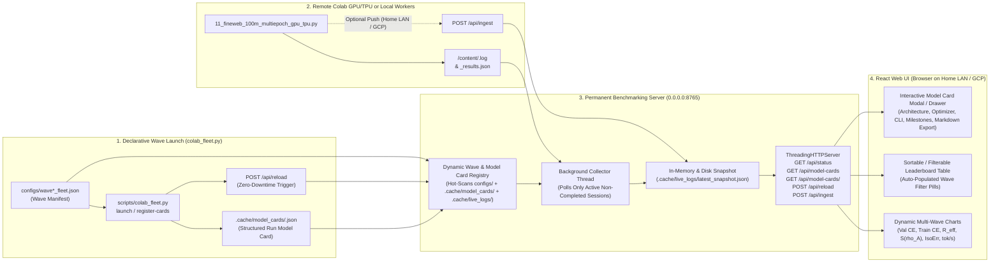

# Experiment Plan 017: Zero-Downtime Permanent Benchmarking Server, Declarative Run Model Cards, Hot-Reloading Wave Discovery, & Home-LAN / GCP Deployment Architecture

---

## 1. Executive Summary & Problem Statement

### 1.1 Project Context (`QuantumDLBlocks` Benchmarking Ecosystem)
`QuantumDLBlocks` is a dual-backend (`PyTorch + Triton` on CUDA GPUs and `JAX + Equinox + Haliax + Pallas` on Google Cloud TPUs) research framework evaluating **Quantum-Geometric Language Models (`QuantumBornGPT`)** and **Single-GPU Classical Speedrun Transformers (`ClassicalModdedGPT`)** on the `FineWeb10B` GPT-2 benchmark (`V = 50,304`, fixed validation sequence length `T_val = 512`, `900M` unique training tokens across 9 shards).

To monitor multi-hour training waves across 5–10 concurrent Colab GPU (`RTX PRO 6000 Blackwell 96GB`, `A100-SXM4 80GB`) and Cloud TPU (`v5e-1`) sessions, we built:
1. **`scripts/colab_fleet.py`**: A declarative CLI fleet manager that reads wave manifest JSON files (`configs/wave*_fleet.json`), provisions sessions, syncs code, launches detached training runs, and harvests `.log` and `_results.json` files into `.cache/live_logs/`.
2. **`scripts/monitor_colab_runs.py`**: A background telemetry collector and interactive React Single-Page Application (SPA) served on `http://0.0.0.0:8765` over the local home network (LAN), displaying real-time validation cross-entropy (`Val CE`), perplexity (`Val PPL`), live training loss frontiers (`Train CE`), hardware utilization (`SM %`, `VRAM`, `MFU %`), and quantum-geometric observables (Readout Effective Quantum Rank $R_{\text{eff}}(\rho_{\text{seed}})$, 10-Qubit Bipartite Entanglement Entropy $S(\rho_A)$, Stiefel/Frame Isometry Error `IsoErr`, and POVM sharpness $\beta$).

### 1.2 The Problem We Are Solving: Why Launching a New Wave Previously Required Server Downtime
In Waves 1 through 8, every time a new experiment wave was designed and launched, the benchmarking web server (`scripts/monitor_colab_runs.py --serve`) had to be **stopped, edited in source code, and restarted**:
1. **Static Hardcoded `FLEET_SPECS` Array**: `scripts/monitor_colab_runs.py` defined its tracked runs inside a hardcoded Python list (`FLEET_SPECS`, lines 68–737) compiled at process startup.
2. **Hardcoded Wave Prefix Conditionals**: Both remote polling eligibility (`rkey.startswith("w8_") or rkey.startswith("w7_") ...`) and wave grouping labels (`if rk.startswith("w8_"): wave_lbl = ...`) were hardcoded `if/elif` chains inside `collect_snapshot()`.
3. **Regex-Only Metadata Reconstruction**: Instead of storing a structured **Model Card** for each training run at launch time, `parse_log_metrics()` attempted to reverse-engineer architectural parameters (`d_seed`, `d_ff`, `Readout`, `Params`) via brittle regular expressions over raw stdout log headers—missing newer architectural and optimizer primitives (such as 3-bank Value Embeddings `ve`, `unet_skip_mode`, `zero_half_rope`, `skip_attn_layers`, `sliding_window`, `doc_mask_attn`, and `optimizer_mode`).

### 1.3 Outcomes We Are Looking to Achieve
1. **Zero-Downtime Dynamic Wave & Run Discovery**:
   - The benchmarking server (`scripts/monitor_colab_runs.py --serve`) must run continuously as a permanent service on the home network (`0.0.0.0:8765`) without ever being stopped or restarted when new waves (`Wave 9`, `Wave 10`, etc.) or ad-hoc runs are launched.
   - New waves and runs must be automatically discovered at runtime from `configs/wave*_fleet.json` and `.cache/model_cards/*.json` (and via an instant hot-reload API endpoint `POST /api/reload`), appearing on the website's graphs, wave filter pills, and leaderboard table within seconds.
2. **Standardized Per-Run "Model Card" Specification (`.cache/model_cards/<run_key>.json`)**:
   - Every model training run in any wave has a structured, self-contained JSON **Model Card** capturing its complete provenance: (a) Identity, Wave, & Hypothesis, (b) Architecture & Quantum/Classical Geometric Primitives, (c) Optimizer & Schedule Configuration, (d) Hardware & Reproducible CLI Command, and (e) Live & Milestone Telemetry (`50M`, `100M`, `200M`, `450M`, `900M` Val CE, Top-1/Top-5, $R_{\text{eff}}$, $S(\rho_A)$, `IsoErr`, $\beta$, and `tok/s`).
   - Model Cards are automatically generated for all historical runs (Waves 1–8) and automatically emitted by `scripts/colab_fleet.py launch` whenever any new wave starts.
3. **Interactive Model Card UI in the Benchmarking Web App**:
   - In the React dashboard on `http://<LAN_IP>:8765`, clicking any run's row or **"Model Card"** button opens an interactive **Model Card Inspector Drawer/Modal** rendering all 5 sections of the run's Model Card, comparing its milestone curve against the `3.28` NanoGPT Speedrun target and project records, and providing one-click Markdown and JSON export.
4. **Permanent Home-Network Service & Cloud-Ready Push/Pull Ingestion (Home LAN Now $\to$ GCP Later)**:
   - Provide a persistent `systemd --user` service definition (`scripts/qdl-benchmark-server.service`) and health-check watchdog for 24/7 operation on the home network (`0.0.0.0:8765`), plus a stateless `POST /api/ingest` telemetry push endpoint so that when the server is eventually hosted on Google Cloud Platform (GCP Cloud Run or Compute Engine), remote Colab/TPU workers can push logs and Model Cards directly to the server over HTTP without requiring local `colab exec` polling.

---

## 2. Architecture of the Zero-Downtime Benchmarking & Model Card System



---

## 3. Detailed Specification of the Run Model Card Schema (`src/qdlblocks/benchmarks/model_card.py`)

Each training run is represented by a validated, JSON-serializable `RunModelCard` dataclass stored at `/home/festivity/agy/QuantumDLBlocks/.cache/model_cards/<run_key>.json`:

```json
{
  "schema_version": "1.0",
  "run_key": "w9_900m_classical_speedrun_v2_pr360",
  "wave_id": "W9",
  "wave_label": "Wave 9 (PR #360 Speedrun & Quantum Unification)",
  "plan_id": "EXPERIMENT_PLAN_016",
  "label": "W9 GPU 900M Classical PR#360 Speedrun V2 (L=12, d=768, T=1024, B=262k, VE=3, ScalarUNet, SkipAttn6, HalfRoPE, DocMask, WSD-0)",
  "short_label": "[gpu_g4_w6_1] W9 Classical PR#360 Speedrun V2 (L=12, d=768)",
  "color": "#00f5d4",
  "default_visible": true,
  "created_at": "2026-10-18T15:00:00-05:00",
  "updated_at": "2026-10-18T15:10:00-05:00",
  "hypothesis_summary": "Tests whether combining all PR #360-era architectural primitives (3-bank Value Embeddings, Scalar U-Net skips, Fused QKV, Layer-6 Attention Skip, Half-Truncated RoPE, Document-Masked Sliding Window) and single-pass chunked CE reaches <= 3.28 Val CE within 900M FineWeb tokens at fixed T_val=512.",
  "architecture": {
    "family": "classical_modded",
    "num_layers": 12,
    "embed_dim": 768,
    "num_heads": 12,
    "head_dim": 64,
    "hidden_dim": 3072,
    "d_ff_display": "3072 (ReLU^2 MLP)",
    "frame_expansion": 4.0,
    "seed_dim": 768,
    "params_M": 159.8,
    "readout_mode": "untied_softcap_30",
    "seed_adapter": "None",
    "zero_init_residual_and_head": true,
    "depth_scaled_residual": true,
    "true_layer0_v_residual": true,
    "num_value_embeddings": 3,
    "unet_skip_mode": "scalar",
    "use_fused_qkv": true,
    "skip_attn_layers": [6],
    "zero_half_rope": true,
    "doc_mask_attn": true,
    "sliding_window": 384,
    "dynamic_povm_beta": false,
    "ortho_decouple": false,
    "povm_log_prior": false,
    "gated_spherical_residual": false,
    "purified_born_attn": false
  },
  "optimization": {
    "optimizer_mode": "muon_adamw",
    "schedule": "WSD",
    "wsd_decay_fraction": 0.25,
    "wsd_min_lr_ratio": 0.0,
    "muon_lr": 0.025,
    "muon_momentum": 0.95,
    "muon_momentum_warmup_steps": 300,
    "batched_newton_schulz": true,
    "stiefel_penalty": 0.0,
    "adamw_lr_wte": 0.20,
    "adamw_lr_head": 0.008,
    "adamw_lr_scalar": 0.02,
    "direct_chunked_ce": true,
    "stage_shard_on_gpu": true
  },
  "data_and_batch": {
    "dataset": "FineWeb10B (GPT-2 Vocab 50,304)",
    "num_shards": 9,
    "epochs": 1,
    "target_tokens_M": 900.0,
    "seq_len_train": 1024,
    "seq_len_val": 512,
    "batch_size": 64,
    "grad_accum": 4,
    "tokens_per_step": 262144
  },
  "hardware": {
    "session": "gpu_g4_w6_1",
    "kind": "gpu",
    "accelerator": "NVIDIA RTX PRO 6000 Blackwell (96GB)",
    "peak_bf16_tflops": 503.8,
    "remote_log": "/content/w9_900m_classical_speedrun_v2_pr360.log",
    "remote_json": "/content/w9_900m_classical_speedrun_v2_pr360_results.json",
    "cli_args": "--backend cuda --architecture classical_modded ..."
  },
  "telemetry": {
    "run_state": "RUNNING",
    "completed": false,
    "current_step": 0,
    "total_steps": 3431,
    "live_tokens_M": 0.0,
    "progress_pct": 0.0,
    "avg_tok_per_s": 0.0,
    "wall_min": 0.0,
    "best_val_ce": null,
    "best_val_ppl": null,
    "best_top1": null,
    "best_top5": null,
    "milestones_val_ce": {
      "50M": null,
      "100M": null,
      "200M": null,
      "450M": null,
      "600M": null,
      "900M": null
    },
    "quantum_observables": {
      "seed_eff_rank": null,
      "entanglement_nats": null,
      "iso_err": null,
      "povm_beta": null,
      "gamma_h": null
    }
  }
}
```

### Automatic CLI-to-Model-Card Parser (`build_model_card_from_manifest_entry`)
- Given any entry in `configs/wave*_fleet.json` (which contains `key`, `session`, `hardware`, `label`, `cli_args`, `remote_log`, `remote_json`) or any legacy entry in `FLEET_SPECS`, `build_model_card_from_manifest_entry(...)` parses `cli_args` using the exact flag definitions of `examples/11_fineweb_100m_multiepoch_gpu_tpu.py` and populates all `architecture`, `optimization`, `data_and_batch`, and `hardware` fields automatically.
- Furthermore, when live log metrics or `_results.json` checkpoints arrive, `update_model_card_telemetry(card, parsed_metrics)` merges the live `telemetry` block (`best_val_ce`, milestone CE at `50M/100M/200M/450M/600M/900M`, `params_M` from the log header, `avg_tok_per_s`, and `quantum_observables`) back into `.cache/model_cards/<run_key>.json` atomically via write-then-rename (`.tmp -> .json`).

---

## 4. Observable Hypotheses & Quantitative Pass/Fail Criteria

### Hypothesis 1 (`H1` — Zero-Downtime Dynamic Wave Registration & Hot Discovery Without Server Restart):
- **Claim**: Replacing the static `FLEET_SPECS` loop in `scripts/monitor_colab_runs.py` with the dynamic `WaveAndModelCardRegistry` allows a newly created wave manifest (`configs/wave*_fleet.json`) or model card (`.cache/model_cards/<run_key>.json`) to be detected and reflected in `/api/status`, `/api/model-cards`, the leaderboard table catalog, and the time-series chart catalog while the HTTP server process remains continuously up (`0` process restarts, `0` dropped HTTP requests).
- **Observable Metrics & Pass Criteria**:
  1. **Zero-Downtime Hot Registration**: With the HTTP server running continuously in a background thread/process, writing a new wave manifest / model card and calling `POST /api/reload` (or waiting one collector cycle) adds the new run to `GET /api/status["runs_catalog"]` and `GET /api/model-cards/<run_key>` with HTTP status `200`, `server_uptime_s` strictly increasing (confirming zero process restart), and reload latency **$< 100\text{ ms}$** (when `skip_remote_poll=True` for local registration).
  2. **Deterministic Color & Wave Grouping**: Any new wave ID (`W9`, `W10`, `W_CUSTOM`) automatically receives a human-readable `wave_label` from its manifest `description` (or `Wave <id>`) and every run without an explicit hex color receives a deterministic, high-contrast color from its `run_key` hash.

### Hypothesis 2 (`H2` — Complete CLI & Log Fidelity of Structured Model Cards Across Classical & Quantum Runs):
- **Claim**: `build_model_card_from_manifest_entry` and `update_model_card_telemetry` accurately extract 100% of architectural, optimization, batch/context, and milestone telemetry fields for both `QuantumBornGPT` and `ClassicalModdedGPT` runs across Waves 1–9, and `render_model_card_markdown(card)` produces a self-contained Markdown Model Card containing all 5 sections.
- **Observable Metrics & Pass Criteria**:
  1. **Backfill Completeness Across All Historical & Wave-9 Runs**: Running `sync_all_model_cards()` over `FLEET_SPECS` + `configs/wave*.json` + `.cache/live_logs/*.log` generates valid `.cache/model_cards/<run_key>.json` files for **$\ge 35$** runs with zero schema validation errors.
  2. **Round-Trip CLI Flag & Telemetry Accuracy**: For a Wave-9 `ClassicalModdedGPT` run (`--num-layers 12 --embed-dim 768 --num-value-embeddings 3 --unet-skip-mode scalar --skip-attn-layers 6 --zero-half-rope --sliding-window 384 --grad-accum 4 --seq-len 1024 --optimizer-mode muon_adamw`) and a Wave-9 `QuantumBornGPT` run (`--frame-expansion 4.0 --seed-dim 512 --purified-born-attn --dynamic-povm-beta`), 100% of parsed model card fields match the input flags and `tokens_per_step` equals `batch_size * seq_len_train * grad_accum` (`262,144`), while `seq_len_val` remains strictly `512`.

### Hypothesis 3 (`H3` — Push Ingestion (`POST /api/ingest`) & Concurrent Home-LAN HTTP Responsiveness):
- **Claim**: Decoupling HTTP request serving from background collection and adding `POST /api/ingest` allows external workers (on the home LAN or GCP) to push log chunks, evaluation checkpoints, and model card updates directly to the server while concurrent `GET /api/status` and `GET /api/model-cards/<run_key>` requests complete in **$< 25\text{ ms}$** p95 latency without blocking on remote `colab exec` locks.
- **Observable Metrics & Pass Criteria**:
  1. **Push Ingestion Update**: Sending a `POST /api/ingest` payload with `run_key`, `model_card`, `log_append`, and `results_json` immediately updates `.cache/live_logs/<run_key>.log`, `.cache/model_cards/<run_key>.json`, and the live in-memory snapshot so the next `GET /api/status` reflects the new step and validation evaluation checkpoints within **$< 50\text{ ms}$**.
  2. **Non-Blocking Read Latency**: Across 50 concurrent `GET /api/status` and `GET /api/model-cards` requests, 100% return HTTP `200` with p95 response time **$< 25\text{ ms}$**.

---

## 5. Planned Code & Architectural Changes

### 5.1 New Model Card & Dynamic Registry Module (`src/qdlblocks/benchmarks/model_card.py`)
Create `/home/festivity/agy/QuantumDLBlocks/src/qdlblocks/benchmarks/model_card.py` (and export in `src/qdlblocks/benchmarks/__init__.py` and `src/qdlblocks/__init__.py`) providing:
1. `RunModelCard` dataclass and `validate_model_card(card: dict[str, Any]) -> list[str]` validator checking all required top-level and nested sections (`architecture`, `optimization`, `data_and_batch`, `hardware`, `telemetry`).
2. `deterministic_run_color(run_key: str) -> str`: Computes a visually distinct, high-saturation hex color on dark backgrounds from `hashlib.sha256(run_key.encode()).digest()` whenever a manifest entry does not specify `"color"`.
3. `parse_cli_args_to_card_sections(cli_args: str) -> tuple[dict[str, Any], dict[str, Any], dict[str, Any]]`: Parses a `11_fineweb_100m_multiepoch_gpu_tpu.py` CLI argument string into `(architecture_dict, optimization_dict, data_and_batch_dict)`.
4. `build_model_card_from_manifest_entry(entry: dict[str, Any], wave_id: str = "W1", wave_description: str = "", plan_id: str = "") -> dict[str, Any]`: Constructs a complete Model Card dict from either a `configs/wave*_fleet.json` run dict or a legacy `FLEET_SPECS` dict.
5. `update_model_card_telemetry(card: dict[str, Any], parsed_log: dict[str, Any]) -> dict[str, Any]`: Updates `telemetry` (`run_state`, `completed`, `current_step`, `total_steps`, `live_tokens_M`, `progress_pct`, `avg_tok_per_s`, `wall_min`, `best_val_ce`, `best_val_ppl`, `best_top1`, `best_top5`, `milestones_val_ce` at `50M, 100M, 200M, 450M, 600M, 900M`, and `quantum_observables`) plus refines `architecture.params_M` if reported in the log header.
6. `render_model_card_markdown(card: dict[str, Any]) -> str`: Formats any Model Card as a clean GitHub-flavored Markdown document suitable for copying/sharing or viewing in the UI.
7. `DynamicWaveRegistry`:
   - Scans `configs/wave*_fleet.json` and `.cache/model_cards/*.json` on every refresh and merges them with the historical `FLEET_SPECS` list (deduplicated by `run_key`, with newer manifest/model-card metadata taking precedence).
   - Determines `should_poll_remote(spec, local_log)` dynamically for **any** wave (polling only runs whose session is currently active in `~/.config/colab-cli/sessions.json` and whose local log does not yet contain `"COMPLETED"`), eliminating hardcoded `rkey.startswith("w8_")` checks forever!

### 5.2 Upgrading `scripts/colab_fleet.py` to Auto-Emit Model Cards & Trigger Zero-Downtime Reloads
In `/home/festivity/agy/QuantumDLBlocks/scripts/colab_fleet.py`:
1. Add a `register-cards` subcommand (`colab_fleet.py register-cards --manifest configs/wave9_fleet.json`) and automatically invoke it inside `cmd_launch`:
   - Before/during launch, generates `.cache/model_cards/<run_key>.json` for every run in the manifest.
   - Sends a non-blocking `POST http://127.0.0.1:8765/api/reload` (timeout `2.0s`, ignoring connection refused if the server isn't running) so the permanent benchmarking website immediately displays the newly launched wave with status `"COMPILING"` / `"RUNNING"` and zero downtime!

### 5.3 Upgrading `scripts/monitor_colab_runs.py` for Zero-Downtime Dynamic Discovery, Model Card APIs, & React Model Card Modal
In `/home/festivity/agy/QuantumDLBlocks/scripts/monitor_colab_runs.py`:
1. **Dynamic Fleet & Wave Discovery in `collect_snapshot()`**:
   - Replace the static `for spec in FLEET_SPECS:` loop with `registry.discover_all_specs()`, which merges `FLEET_SPECS`, all `configs/wave*_fleet.json` manifests (including `wave9_fleet.json` and any future `wave10_fleet.json`, etc.), and `.cache/model_cards/*.json`.
   - Automatically write/update `.cache/model_cards/<run_key>.json` for every run during `collect_snapshot()` and attach `"model_card": card` to each entry in `runs_catalog`.
   - Group runs by Session (`sess`) when polling remote Colab sessions so if multiple historical waves used the same session name (e.g. `gpu_g4_w6_1`), `fetch_colab_fleet_member` only polls the **currently active run** on that session!
2. **New Zero-Downtime HTTP Endpoints**:
   - `GET /api/model-cards`: Returns `{"model_cards": {run_key: card, ...}, "count": N}`.
   - `GET /api/model-cards/<run_key>`: Returns the structured JSON Model Card (or Markdown if `?format=md` is passed).
   - `POST /api/reload`: Triggers an immediate registry re-scan (`configs/wave*_fleet.json` + `.cache/model_cards/*.json` + local `.cache/live_logs/`) and updates `_LATEST_SNAPSHOT` in memory in `< 100 ms` without waiting for slow remote `colab exec` calls, returning `{"ok": true, "runs_count": N, "uptime_s": ...}`.
   - `POST /api/ingest`: Accepts JSON `{"run_key": ..., "model_card": optional_dict, "log_append": optional_str, "log_full": optional_str, "results_json": optional_list}` (optionally authenticated via `Authorization: Bearer <QDL_INGEST_TOKEN>` when `QDL_INGEST_TOKEN` env var is set for GCP/WAN security), writes the updated log/JSON/card to disk, refreshes `_LATEST_SNAPSHOT` in memory, and returns `{"ok": true}`.
3. **Interactive Model Card Drawer / Modal in the React Frontend**:
   - Add a **"🃏 Card"** button on every row in the Leaderboard Table (and clicking the run title opens the Model Card modal).
   - The **Model Card Modal** displays:
     - Header with Run Title, Wave badge, Status badge (`RUNNING`, `COMPLETED`, `OOM_CRASH`), Color swatch, and **"Copy Markdown"** / **"Copy JSON"** buttons.
     - **Section 1: Hypothesis & Milestone Summary** (`50M`, `100M`, `200M`, `450M`, `600M`, `900M` Val CE, Best Val CE vs. `3.280` Speedrun target, Val PPL, Top-1 / Top-5 Accuracy, `tok/s`).
     - **Section 2: Architecture & Geometric Primitives** (Family, $L, d, H, d_h, d_{\text{ff}}, D_{\text{seed}}$, Params, Readout mode, Value Embeddings `ve`, U-Net skip mode, Fused QKV, Skipped Attention Layers, Half-Truncated RoPE, Document Mask + Sliding Window, and Quantum EarlyFix flags).
     - **Section 3: Optimizer & Schedule** (`optimizer_mode`, `schedule`, WSD decay & min LR ratio, Muon LR & momentum warmup, AdamW group LRs, Direct Chunked CE, On-GPU Shard Staging).
     - **Section 4: Quantum Observables** ($R_{\text{eff}}(\rho_{\text{seed}})$, 10-Qubit Entanglement $S(\rho_A)$, `IsoErr`, POVM $\beta$, $\gamma_h$).
     - **Section 5: Hardware & Reproducible CLI Command** (with one-click copy).
4. **Permanent Home-Network Service Unit (`scripts/qdl-benchmark-server.service` & `scripts/ensure_benchmark_server.sh`)**:
   - Create `scripts/qdl-benchmark-server.service` (a `systemd --user` unit file) and `scripts/ensure_benchmark_server.sh` (an idempotent helper script that checks `http://127.0.0.1:8765/api/status`, starts the server in the background if not running, or triggers `POST http://127.0.0.1:8765/api/reload` if already running—never killing an healthy running server!).

---

## 6. Verification & Testing Plan

1. **Unit Test Suite (`tests/test_hypothesis_017_zero_downtime_model_cards.py`)**:
   - `test_cli_to_model_card_parser_classical_and_quantum`: Verifies that `build_model_card_from_manifest_entry` accurately parses all Wave-9 classical (`PR #360`, `Pure AdamW`) and quantum (`4d-Frame`, `Asym-1024`) manifest entries into valid `RunModelCard` dicts with zero validation errors and renders complete Markdown via `render_model_card_markdown`.
   - `test_dynamic_wave_registry_hot_discovery_without_restart`: Verifies that `DynamicWaveRegistry` discovers `configs/wave*_fleet.json` and dynamically added wave manifests in a temporary directory without code changes or process restarts.
   - `test_zero_downtime_http_reload_and_ingest_endpoints`: Starts the HTTP server on an ephemeral local port, verifies `GET /api/status`, registers a brand-new Wave-10 run via `POST /api/ingest` and `POST /api/reload`, and verifies that `GET /api/status` and `GET /api/model-cards/<run_key>` immediately include the new run with `uptime_s` monotonically increasing and response latency `< 25 ms`.
   - `test_session_deduplicated_remote_polling_selection`: Verifies that when multiple historical waves (`W6`, `W7`, `W8`, `W9`) share the same Colab session name (`gpu_g4_w6_1`), the collector only marks the latest active/incomplete run on that session for live remote polling.
2. **Controlled Verification Script (`examples/27_verify_zero_downtime_benchmark_server.py`)**:
   - Backfills `.cache/model_cards/<run_key>.json` for all historical and Wave-9 runs, runs `H1`, `H2`, and `H3` benchmarks against a live local server instance, and writes `/home/festivity/agy/QuantumDLBlocks/.cache/hypothesis_experiments_017.json`.
