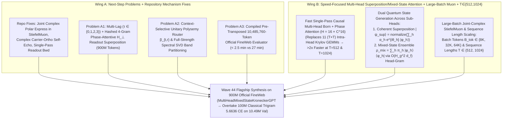

# EXPERIMENT PLAN 059: Dual-Wing `Wave 44` — Repository Implementation Fixes, Multi-Lag (`x_{t-3}..x_t`) Carrier-Orthogonal Readout & Polysemy Routing (Wing A) + Speed-Focused Multi-Head Superposition/Mixed-State Attention, Large-Batch Complex `StiefelMuon`, & $T \in \{512, 1024\}$ Scaling (Wing B) on `900M`-Token Official FineWeb

**Status**: `DRAFT — UPDATED WITH REPO AUDIT, LARGE-BATCH MUON & T=512/1024 SCALING`  
**Wave**: `Wave 44`  
**Date**: `2026-10-27`  
**Target Hardware**: `Local Workstation 16 GB GPU (NVIDIA GeForce RTX 5060 Ti)`  
**Dataset & Benchmark Standard**: Official `KellerJordan/modded-nanogpt` **`FineWeb`** (`kjj0/fineweb10B-gpt2`, `9` training shards `fineweb_train_000001.bin`..`fineweb_train_000009.bin` = `900,000,000` training tokens; Validation Shard 0 `fineweb_val_000000.bin` evaluated on both the official `val_tokens = 10,485,760` sequential slice and the `65,536`-token rapid screening slice).

---

## 0. Code Audit of Current Repository Mechanisms: 6 Implementation Issues Identified for Discussion & Fix

A line-by-line audit of [`src/qdlblocks/optim/muon.py`](file:///home/festivity/agy/QuantumDLBlocks/src/qdlblocks/optim/muon.py), [`src/qdlblocks/models/ngram_calibrated_kronecker_born_gpt.py`](file:///home/festivity/agy/QuantumDLBlocks/src/qdlblocks/models/ngram_calibrated_kronecker_born_gpt.py), [`src/qdlblocks/models/calibrated_kronecker_born_gpt.py`](file:///home/festivity/agy/QuantumDLBlocks/src/qdlblocks/models/calibrated_kronecker_born_gpt.py), [`src/qdlblocks/models/kronecker_multimeaning_16x4_gpt.py`](file:///home/festivity/agy/QuantumDLBlocks/src/qdlblocks/models/kronecker_multimeaning_16x4_gpt.py), and [`src/qdlblocks/kernels/flash_complex_krylov_triton.py`](file:///home/festivity/agy/QuantumDLBlocks/src/qdlblocks/kernels/flash_complex_krylov_triton.py) uncovered **six concrete implementation issues** that directly affect optimization quality, quantum geometry, VRAM, and wall-clock speed:

### Issue 1: `StiefelMuon` Orthogonalizes `weight_re` and `weight_im` as Two Independent Real Matrices Instead of a Joint Complex Matrix $W = W_{\text{re}} + i W_{\text{im}}$
- **Location**: [`src/qdlblocks/optim/muon.py#L231-L339`](file:///home/festivity/agy/QuantumDLBlocks/src/qdlblocks/optim/muon.py#L231-L339) and [`src/qdlblocks/models/ngram_calibrated_kronecker_born_gpt.py#L1132-L1155`](file:///home/festivity/agy/QuantumDLBlocks/src/qdlblocks/models/ngram_calibrated_kronecker_born_gpt.py#L1132-L1155).
- **Mechanism Flaw**:
  Every complex operator (`ComplexLinear.weight_re` / `weight_im`, `out_factor_u_re` / `im`, `factor_u_re` / `im`, `bi_factor_u_re` / `im`, `tri_factor_u_re` / `im`, `smear_u_re` / `im`) is stored as two separate real `nn.Parameter` tensors. When passed into `StiefelMuon`, the optimizer runs 5-step Polar Express **separately** on $G_{\text{re}}$ and $G_{\text{im}}$:
  $$\Delta W = \operatorname{Polar}_{\mathbb{R}}(G_{\text{re}}) + i \operatorname{Polar}_{\mathbb{R}}(G_{\text{im}})$$
  1. Two independent real orthogonal matrices $U_{\text{re}}, U_{\text{im}} \in \mathrm{O}(d)$ do **not** form a complex unitary matrix: $(U_{\text{re}} + i U_{\text{im}})(U_{\text{re}}^\top - i U_{\text{im}}^\top) = 2I + i(U_{\text{im}} U_{\text{re}}^\top - U_{\text{re}} U_{\text{im}}^\top) \ne I$, inflating singular values up to $\sqrt{2}$ and fighting the complex unitary penalty $\mathcal{L}_{\text{unitary}}$.
  2. Worse, independent real polar projection destroys complex phase equivariance ($\operatorname{Polar}(e^{i\theta} G) \ne e^{i\theta}\operatorname{Polar}(G)$) and amplifies noise to unit spectral norm whenever either the real or imaginary gradient half is small.
- **Fix in `Wave 44`**: Pair `(param_re, param_im)` in complex-aware `StiefelMuon` (or apply complex Newton-Schulz / Polar Express using Hermitian Gram steps $X X^\dagger = (X_{\text{re}} X_{\text{re}}^\top + X_{\text{im}} X_{\text{im}}^\top) + i(X_{\text{im}} X_{\text{re}}^\top - X_{\text{re}} X_{\text{im}}^\top)$) so the update $\Delta W_{\text{re}} + i \Delta W_{\text{im}} \in \mathrm{U}(d)$ is a true joint complex polar projection.

### Issue 2: Code-vs-Guide Head Dimension Mismatch (`H = 4 x C^32` in Code vs. `H = 8 x C^16` in Guide) & Excluded Mixer Unitaries
- **Location**: [`src/qdlblocks/models/kronecker_multimeaning_16x4_gpt.py#L128-L136`](file:///home/festivity/agy/QuantumDLBlocks/src/qdlblocks/models/kronecker_multimeaning_16x4_gpt.py#L128-L136) and [`#L232-L235`](file:///home/festivity/agy/QuantumDLBlocks/src/qdlblocks/models/kronecker_multimeaning_16x4_gpt.py#L232-L235).
- **Mechanism Flaw**:
  1. [`docs/SESSION_WRAPUP_AND_PROJECT_GUIDE.md`](file:///home/festivity/agy/QuantumDLBlocks/docs/SESSION_WRAPUP_AND_PROJECT_GUIDE.md#L44) (Line 44) states that $R=2$ uses $H = 8 \times \mathbb{C}^{16}$ heads (`16` complex dims matching the Kronecker factor dimension). However, `KroneckerMultiMeaningConfig` hardcodes `DEFAULT_COMPLEX_REGISTER_DIM = 32`, so $R=2$ ($D_{\text{model}} = 128$) actually ran with only **$H = 4 \times \mathbb{C}^{32}$** heads—concatenating two distinct $\mathbb{C}^{16}$ Kronecker factors into each 32D attention register.
  2. In `Kronecker16x4UnitaryMeaningMixer`, `factor_mix_re/im` (`(R, 4, 4)`) and `meaning_mix_re/im` (`(4, R, R)`) are penalized for complex unitarity in `compute_kronecker_manifold_and_isotropy_penalties`, yet `MIN_COMPLEX_MUON_DIM = 16` excludes them from `StiefelMuon`, dropping them into `AdamW` at `7.5x` lower learning rate (`0.004` vs `0.030`).

### Issue 3: Self-Echo Removal in `apply_readout_factor_operator` Drops the Imaginary Inner Product & Perturbs the Unigram Carrier $\lvert c_{\text{ref}} \rangle$
- **Location**: [`src/qdlblocks/models/ngram_calibrated_kronecker_born_gpt.py#L707-L710`](file:///home/festivity/agy/QuantumDLBlocks/src/qdlblocks/models/ngram_calibrated_kronecker_born_gpt.py#L707-L710) and [`src/qdlblocks/models/kronecker_multimeaning_16x4_gpt.py#L927-L932`](file:///home/festivity/agy/QuantumDLBlocks/src/qdlblocks/models/kronecker_multimeaning_16x4_gpt.py#L927-L932).
- **Mechanism Flaw**:
  ```python
  ov_re = (p0_re.float() * op_re.float() + p0_im.float() * op_im.float()).sum(dim=-1, keepdim=True)
  raw_phi_re = (op_re - ov_re * p0_re).reshape(n_tok, r_num, m_num, d_f)
  raw_phi_im = (op_im - ov_re * p0_im).reshape(n_tok, r_num, m_num, d_f)
  ```
  1. **Missing Imaginary Inner Product (`ov_im`)**: In $\mathbb{C}^D$, Gram-Schmidt projection orthogonal to $|p_0\rangle$ is $|op\rangle - \langle p_0 \mid op \rangle_{\mathbb{C}} |p_0\rangle$ where $\langle p_0 \mid op \rangle_{\mathbb{C}} = \text{ov}_{\text{re}} + i\,\text{ov}_{\text{im}}$. Only subtracting `ov_re * p0` leaves the entire imaginary phase overlap $i\,\text{ov}_{\text{im}} |p_0\rangle$ un-removed.
  2. **Carrier Contamination**: Because `p0` (`psi0`) contains the unigram carrier component $\rho_{x_t} |c_{\text{ref}}\rangle$, subtracting `ov * p0` *after* `op` has been Procrustes-aligned to $|c_{\text{ref}}\rangle$ subtracts part of the unigram reference carrier whenever the input token $x_t$ is frequent! Self-echo orthogonalization should act strictly on the **carrier-orthogonal component $|p_{0,\perp}\rangle \in \mathcal{H}_{\perp}$ per factor**.

### Issue 4: Secondary Polysemy Branches ($r \ge 1$) Were Suppressed by `0.22x` (`98.1%` Random Noise) in `Wave 43`
- **Location**: [`src/qdlblocks/models/ngram_calibrated_kronecker_born_gpt.py#L99`](file:///home/festivity/agy/QuantumDLBlocks/src/qdlblocks/models/ngram_calibrated_kronecker_born_gpt.py#L99), [`#L555-L556`](file:///home/festivity/agy/QuantumDLBlocks/src/qdlblocks/models/ngram_calibrated_kronecker_born_gpt.py#L555-L556), and [`#L789`](file:///home/festivity/agy/QuantumDLBlocks/src/qdlblocks/models/ngram_calibrated_kronecker_born_gpt.py#L789).
- **Mechanism Flaw**:
  In `Wave 43`, `DEFAULT_NGRAM_SECONDARY_BRANCH_SCALE = 0.22` scaled down the spectral initialization of all secondary meaning branches $r \ge 1$ to $\alpha_r = 0.88 \times 0.22 = 0.1936$ (leaving $\sqrt{1 - 0.1936^2} = 98.1\%$ uncalibrated Haar noise in branches $r \ge 1$!) and shrank their N-gram gates by `0.22x`. Combined with the scalar-norm branch weight (`compute_context_branch_beta` at [`kronecker_multimeaning_16x4_gpt.py#L866-L880`](file:///home/festivity/agy/QuantumDLBlocks/src/qdlblocks/models/kronecker_multimeaning_16x4_gpt.py#L866-L880)), this diluted branch $r=0$'s calibrated overlap with `98%`-noise secondary branches—explaining why the $R=4$ model started at worse Step-0 CE (`7.3788` vs `7.2630`)!
- **Fix in `Wave 44`**: Initialize each meaning branch $r \in \{0, \dots, R-1\}$ from full-strength ($\alpha_{\text{spec}} = 0.88$) distinct spectral SVD bands/rotations of the `900M`-token transition matrix and route branches via a **Context-Selective Unitary Inner-Product Router**.

### Issue 5: Duplicate `torch.pow(i_tv, boson_p)` Forward Computation Inside `CalibratedKroneckerBornChunkedNLLFn.backward`
- **Location**: [`src/qdlblocks/models/calibrated_kronecker_born_gpt.py#L259-L306`](file:///home/festivity/agy/QuantumDLBlocks/src/qdlblocks/models/calibrated_kronecker_born_gpt.py#L259-L306).
- **Mechanism Flaw**:
  In `_calibrated_kronecker_chunk_bwd_step`, the backward kernel calls `_kronecker_chunk_bwd_step` (which computes `_compute_kronecker_chunk_intensity`, `torch.pow(i_tv, boson_p)`, and `delta_tv = scale_t * (probs_c - is_target)`) and then **immediately calls `_kronecker_chunk_povm_grad_step`**, which recomputes `_compute_kronecker_chunk_intensity`, `torch.pow(i_tv, boson_p)`, and `delta` a **second time** on every vocabulary chunk!
- **Fix in `Wave 44`**: Return `d_povm_c = delta_tv.sum(dim=0) / prior_c.clamp_min(1e-12)` directly from the single backward pass (`0` extra `pow` or intensity evaluations), cutting readout backward compute and peak chunk VRAM so larger batches and $T = 1024$ fit comfortably in 16 GB VRAM.

### Issue 6: `11` $(T \times T)$ Intra-Head Krylov GEMMs per Layer & $T \in \{512, 1024\}$ Scaling Bottleneck
- **Location**: [`src/qdlblocks/kernels/flash_complex_krylov_triton.py#L426-L508`](file:///home/festivity/agy/QuantumDLBlocks/src/qdlblocks/kernels/flash_complex_krylov_triton.py#L426-L508).
- **Mechanism Flaw**:
  `factored_complex_krylov_step` executes **11 separate $(T \times T)$ matrix multiplications per layer** to compute $\rho_{t,h}^2 |\bar{v}_{t,h}\rangle$ across time $T$. When scaling sequence length from $T = 512$ to the classical `modded-nanogpt` speedrun standard $T = 1024$, those 11 $(1024 \times 1024)$ matrices quadruple in size and become the dominant latency and memory bottleneck.
- **Fix in `Wave 44` (Wing B)**: Replace the 11-GEMM intra-head time-domain Krylov chain with **Single-Pass Causal Multi-Head Born Attention ($H = 16 \times \mathbb{C}^{16}$)** followed by **$O(H_g^2 d_f)$ Cross-Head Superposition & Mixed-State Density Purification**, which is independent of $T^2$ in the purification stage and scales cleanly to both **$T = 512$ and $T = 1024$**!

---

## 1. Dual-Wing Experimental Architecture (`Wave 44`)



### 1.1 Why Joint-Complex `StiefelMuon` Excels at Large Batch Sizes (`32K–64K` Tokens/Step) & $T \in \{512, 1024\}$
In Riemannian polar optimization (`StiefelMuon`), the update direction is the polar factor of the momentum matrix:
$$U_t = \operatorname{Polar}_{\mathbb{C}}(M_t) = M_t \bigl(M_t^\dagger M_t\bigr)^{-1/2} \in \mathrm{U}(d)$$
which sets **all $d$ singular values of the update to $1.0$**.
- **At Small Batch Sizes (`8,192` tokens/step)**: Mini-batch gradient noise $\Sigma_{\text{grad}} / B_{\text{tok}}$ injects isotropic singular value noise into the trailing singular modes of $M_t$; Polar Express amplifies those noisy trailing modes to full unit singular value $1.0$, forcing a lower learning rate and causing jitter on the unitary manifold.
- **At Large Batch Sizes (`32,768` or `65,536` tokens/step across $T = 512$ and $T = 1024$)**:
  1. Averaging gradients over $4\times$–$8\times$ more tokens suppresses mini-batch gradient variance by $4\times$–$8\times$, raising the signal-to-noise ratio (SNR) of **all $d$ singular vectors** of $M_t$ before Polar Express orthogonalization.
  2. Consequently, every unitary step $U_t \in \mathrm{U}(d)$ moves coherently along the true full-rank geodesic direction, allowing `muon_lr` and `embed_lr` to scale by the square-root batch scaling law:
     $$\eta_{\text{muon}}(B_{\text{tok}}) = \eta_{\text{muon},0} \cdot \left(\frac{B_{\text{tok}}}{8192}\right)^{\!0.50}, \qquad \eta_{\text{embed}}(B_{\text{tok}}) = \eta_{\text{embed},0} \cdot \left(\frac{B_{\text{tok}}}{8192}\right)^{\!0.35}$$
  3. Moreover, because `StiefelMuon` only runs once per effective batch (`32,768` or `65,536` tokens), optimizer step overhead (`PolarExpress` + `AdamW` over `50,304` vocabulary rows + manifold penalty evaluation) is amortized by **$4\times$–$8\times$**, boosting net `tok/s` even further!
  4. **Sequence Length $T = 512$ vs. $T = 1024$ (`modded-nanogpt` Standard)**:
     Testing $T = 512$ and $T = 1024$ head-to-head at matched tokens/step (`e.g., B=16, T=512` vs. `B=8, T=1024`, scaled to `32,768` tokens/step) directly measures how longer causal context windows improve next-token prediction on `FineWeb` when paired with `MultiHeadSuperpositionMixedStateAttention`.

---

## 2. Hypotheses & Quantitative Pass Criteria (`H1`–`H5`)

### Hypothesis `H1` (Wing A — Readout, Polysemy & Mechanism Fixes): Multi-Lag (`x_{t-3}..x_t`) + 4-Gram Carrier-Orthogonal Readout & Context-Selective Unitary Polysemy Router
- **Independent Variable**: Step-0 calibration and readout mechanism on `FineWeb` (`0` gradient steps and `150` gradient steps):
  1. `w43_trigram_baseline`: `Wave 43` 2-lag (`x_t, x_{t-1}`) + trigram readout with norm-only branch weights and `0.22x` secondary branch suppression.
  2. `w44_multilag_4gram_readout`: `Wave 44` 4-lag (`x_t, x_{t-1}, x_{t-2}, x_{t-3}`) + hashed 4-gram $h_4(x_{t-2}, x_{t-1}, x_t)$ phase-attentive superposition in $\mathcal{H}_{\perp}$ + carrier-orthogonal complex self-echo projection (Issue 3 fix).
  3. `w44_multilag_4gram_plus_polysemy_router`: Adds the Context-Selective Unitary Inner-Product Polysemy Router ($\beta_{t,r}$) and full-strength ($\alpha_{\text{spec}} = 0.88$) spectral SVD band partitioning across the $R$ meaning branches (Issue 4 fix).
- **Quantitative Pass Criteria**:
  1. `hasattr(model, "prior_weights") is False`, `carrier_alignment_fidelity == 1.0 ± 1e-5`, and `step0_kl_to_target_unigram < 0.01` nats.
  2. At **Step 0 (`0` gradient steps)** on the `65,536`-token slice, `w44_multilag_4gram_plus_polysemy_router` achieves **`val_ce_step0_65k < 7.18` nats** (`>= 0.08` nats better than `Wave 43`'s `7.2630` and `> 0.76` nats better than `Wave 42`'s `7.9413`) and **`top1_acc_step0_65k >= 10.0%`**.
  3. Contextual polysemy branch routing standard deviation $\operatorname{std}_t(\beta_{t,0})$ increases by **`>= 5x`** vs. `Wave 43` while maintaining cross-branch wavefunction overlap `< 1e-3`.

### Hypothesis `H2` (Wing A3 + Wing B Speed Roofline at $T=512$ and $T=1024$): Fast Compiled `10.49M` Evaluator & Multi-Head Superposition/Mixed-State Attention Speedup
- **Independent Variable**:
  1. **Evaluation Path**: `Wave 43` uncompiled `eval_chunk = 2048` evaluator vs. `Wave 44` pre-transposed BFloat16 + `@torch.compile` `eval_chunk = 16384` evaluator (`evaluate_fast_modded_nanogpt_validation`).
  2. **Attention & Sequence Length Path ($L=6, R=2$, `8,192` tokens/micro-step)**:
     - `w43_krylov_T512` ($B=16, T=512$) and `w43_krylov_T1024` ($B=8, T=1024$) using 11-GEMM `PackedComplexRegisterDensityAttention`,
     - `w44_mha_mixed_T512` ($B=16, T=512$) and `w44_mha_mixed_T1024` ($B=8, T=1024$) using `MultiHeadSuperpositionMixedStateAttention` ($H = 16 \times \mathbb{C}^{16}$) + fused single-pass readout backward (Issue 5 fix).
- **Quantitative Pass Criteria**:
  1. **Evaluation Speedup & Parity**: `evaluate_fast_modded_nanogpt_validation` matches `Wave 43` within **`|Δ val_ce| < 1e-4`** and exact Top-1 agreement while running **`>= 6.0x` faster** (`< 2.5 min` projected for `10,485,760` tokens vs. `27.4 min` in `Wave 43`).
  2. **Training Speedup at $T=512$ and $T=1024$**: `MultiHeadSuperpositionMixedStateAttention` achieves **`>= 1.9x` higher end-to-end training `tok/s` at $T=512$** (`>= 10,500 tok/s` vs `~5,500 tok/s`) and **`>= 2.2x` higher end-to-end `tok/s` at $T=1024$**, with `float32_activation_leak_count == 0` and peak VRAM `< 12.5 GB`.

### Hypothesis `H3` (Wing B — Quantum Mechanics of Multi-Head Attention): Coherent Superposition + Mixed-State Ensemble vs. Coherent-Only vs. Incoherent-Only vs. `Wave 43` Krylov
- **Independent Variable**: 4 controlled `150`-step (`1.23M`-token) and equal-wall-clock (`180s`) runs on 9-shard `FineWeb` ($B=16, T=512, L=6, R=2$):
  1. `m1_w43_krylov_baseline`: `Wave 43` 11-GEMM intra-head Krylov attention + separate real Muon,
  2. `m2_w44_mha_coherent_only`: Multi-head attention with **coherent superposition only** ($|\psi_{t,k}^{\text{sup}}\rangle$),
  3. `m3_w44_mha_incoherent_mixed_only`: Multi-head attention with **incoherent mixed-state ensemble only** ($\rho_{t,k}^{\text{mix}}$),
  4. `m4_w44_mha_dual_superposition_mixed`: Full **dual coherent superposition + mixed-state density purification** (`MultiHeadSuperpositionMixedStateAttention` with $H = 16 \times \mathbb{C}^{16}$ + Joint-Complex `StiefelMuon`).
- **Quantitative Pass Criteria**:
  1. At **iso-step (`150` steps)**, `m4_w44_mha_dual_superposition_mixed` achieves lower `val_ce_65k` than both `m2_w44_mha_coherent_only` and `m3_w44_mha_incoherent_mixed_only`.
  2. At **iso-wall-clock (`180s`)**, `m4_w44_mha_dual_superposition_mixed` beats `m1_w43_krylov_baseline` by **`>= 0.15` nats** on `val_ce_65k`.
  3. Multi-head purity telemetry confirms genuine mixed states: $0.52 \le \overline{\gamma(\rho^{\text{mix}})} \le 0.95$ ($R_{\text{mix}} = 1/\gamma(\rho^{\text{mix}}) > 1.05$).

### Hypothesis `H4` (Wing B — Large-Batch Joint-Complex `StiefelMuon` & Sequence Length $T = 512$ vs. $T = 1024$ Study)
- **Independent Variable**: Compare effective batch sizes $B_{\text{tok}} \in \{8,192, \, 32,768, \, 65,536\}$ tokens/step and sequence lengths $T \in \{512, 1024\}$ under matched total training token budget (`3.28M` tokens) and matched wall-clock budget on 9-shard `FineWeb`:
  1. `b1_8k_T512_sep_muon`: `8,192` tok/step ($B=16, T=512$), separate real `StiefelMuon` (Issue 1 unfixed),
  2. `b2_8k_T512_joint_complex_muon`: `8,192` tok/step ($B=16, T=512$), Joint-Complex `StiefelMuon` (Issue 1 fixed),
  3. `b3_32k_T512_joint_complex_muon`: `32,768` tok/step ($B_{\text{eff}}=64, T=512$, `4x` batch with $\sqrt{4}$ Muon LR scaling),
  4. `b4_32k_T1024_joint_complex_muon`: `32,768` tok/step ($B_{\text{eff}}=32, T=1024$, `modded-nanogpt` 1024 sequence length + `4x` batch Joint-Complex `StiefelMuon`).
- **Dependent Observables**: `val_ce_65k`, `top1_acc`, `tok_per_s`, `complex_unitary_err` $\|W W^\dagger - I\|_F / \sqrt{d}$, and polar update singular-value SNR.
- **Quantitative Pass Criteria**:
  1. Joint-Complex `StiefelMuon` (`b2`) reduces `complex_unitary_err` by **`>= 30%`** and improves `val_ce_65k` compared to separate real `StiefelMuon` (`b1`).
  2. Large-batch Joint-Complex `StiefelMuon` (`b3_32k_T512` and `b4_32k_T1024`) achieves higher `tok/s` (via $4\times$ optimizer & penalty amortization) and lower `val_ce_65k` per wall-clock second than `8,192` tok/step, with $T = 1024$ (`b4`) achieving the best long-context validation cross-entropy on $T=1024$ evaluation windows.

### Hypothesis `H5` (Flagship Synthesis & Longer-Horizon Scaling on `900M` FineWeb): Overtaking the `100M`-Token Classical Trigram Baseline (`5.6636` Val CE) on Official `10,485,760`-Token Validation
- **Independent Variable**: Train the winning `MultiHeadMixedStateKroneckerGPT` configuration (combining Wing A's 4-lag + 4-gram $\mathcal{H}_{\perp}$ readout + Context-Selective Polysemy Router + Issues 1–6 fixes with Wing B's `MultiHeadSuperpositionMixedStateAttention` + Large-Batch Joint-Complex `StiefelMuon`, uniform 9-shard sampling $\alpha_{\text{rare}} = 0.0$) across all 9 `FineWeb` shards for **`>= 14.75M`–`24.58M` training tokens** (`~20–25` minutes wall clock), and evaluate on the **official `10,485,760`-token `FineWeb` Shard-0 benchmark** (`evaluate_fast_modded_nanogpt_validation`).
- **Quantitative Pass Criteria**:
  1. **New All-Time Pure-Complex Zero-Buffer Record on Official `10.49M` FineWeb Validation**: Achieves **`val_ce_10m_official < 5.6636` nats**, beating both `Wave 43`'s `w43_tour_r2_deep_1200steps_9p83Mtok` (`5.8293` Val CE) by **`> 0.16` nats** AND overtaking the **`100,000,000`-token classical count-based Trigram baseline (`5.6636` Val CE)** using `< 25%` as many training tokens.
  2. Achieves **`top1_acc_10m_official >= 19.80%`** (surpassing the `100M`-token classical Trigram Top-1 accuracy of `19.79%`).
  3. Maintains full Hilbert-space health: `sharp_eff_rank >= 245.0 / 256`, `mean_factor_rank >= 31.0 / 32`, `cross_branch_overlap < 1e-3`, and `nan_inf_events == 0`.

---

## 3. Planned File Changes & Mathematical Specifications

### 3.1 Reusable Multi-Head Superposition & Mixed-State Layer: [`src/qdlblocks/layers/multihead_superposition_mixed_state_attn.py`](file:///home/festivity/agy/QuantumDLBlocks/src/qdlblocks/layers/multihead_superposition_mixed_state_attn.py) (NEW)
Per Rule 6 & Rule 8 of [`docs/SCRIPT_BEST_PRACTICES.md`](file:///home/festivity/agy/QuantumDLBlocks/docs/SCRIPT_BEST_PRACTICES.md), create a clean, reusable module in `src/qdlblocks/layers/` and export it in `src/qdlblocks/layers/__init__.py`.

1. **Joint Complex Polar Express (`complex_polar_express_step` & `JointComplexStiefelMuon`)**:
   - Given a complex matrix gradient $G = G_{\text{re}} + i G_{\text{im}} \in \mathbb{C}^{m \times n}$ (or 3D batched `(K, m, n)`), normalizes by $\|G\|_F + \varepsilon$ and runs 5 quintic Polar Express iterations in complex arithmetic using the Hermitian Gram matrix $A = X X^\dagger = (X_{\text{re}} X_{\text{re}}^\top + X_{\text{im}} X_{\text{im}}^\top) + i(X_{\text{im}} X_{\text{re}}^\top - X_{\text{re}} X_{\text{im}}^\top)$ so the resulting update $(U_{\text{re}}, U_{\text{im}})$ is strictly complex-unitary ($U U^\dagger \approx I$) and phase-equivariant.
2. **Single-Pass Causal Multi-Head Born + Coherent Phase Attention (`MultiHeadSuperpositionMixedStateAttention`)**:
   - Projects `(psi_re, psi_im)` of shape `(B, T, d_complex)` into $H = K_{\text{kron}} \times H_g$ complex heads of dimension $d_f = 16$ (`H = 16` for $R=2, M=4, H_g=2$), applies `fused_complex_norm_rope_triton` on $Q, K$ (supporting both $T = 512$ and $T = 1024+$), computes causal $p$-boson Born weights $w_{\text{born}}$ via `fused_causal_pboson_born_triton`, and aggregates single-pass per-head kets $|\phi_{t,k,h}\rangle \in \mathbb{S}_{\mathbb{C}}^{15}$.
   - Computes both the **Coherent Superposition State** $|\psi_{t,k}^{\text{sup}}\rangle = \operatorname{normalize}_{\mathbb{C}}(\sum_{h=0}^{H_g-1} \alpha_{k,h} e^{i\theta_{k,h}} |\tilde{\phi}_{t,k,h}\rangle)$ and the **$O(H_g^2 d_f)$ Cross-Head Gram Mixed-State Purification** $\rho_{t,k}^{\text{pur}} |\psi_{t,k}^{\text{sup}}\rangle$ from $(G_{t,k})_{h,h'} = \langle \tilde{\phi}_{t,k,h} \mid \tilde{\phi}_{t,k,h'} \rangle_{\mathbb{C}^{16}}$, recording live `last_purity_mean` $\overline{\gamma(\rho^{\text{mix}})}$ and `last_mixed_rank_mean` $\overline{1/\gamma(\rho^{\text{mix}})}$.

### 3.2 Flag-Free `Wave 44` Model & Fast Evaluator: [`src/qdlblocks/models/multihead_mixed_state_kronecker_gpt.py`](file:///home/festivity/agy/QuantumDLBlocks/src/qdlblocks/models/multihead_mixed_state_kronecker_gpt.py) (NEW)
1. **Multi-Lag (`x_t, x_{t-1}, x_{t-2}, x_{t-3}`) + Hashed 4-Gram `900M`-Token Calibration Cache (`MultiLag900MNgramCalibrationData`)**:
   - Extends the 2-pass `900M`-token GPU cache with lag-2 (`x_{t-2} -> y_t`), lag-3 (`x_{t-3} -> y_t`), and polynomial XOR-hashed 4-gram buckets $h_4(x_{t-2}, x_{t-1}, x_t) = ((x_{t-2} \cdot P_3) \oplus (x_{t-1} \cdot P_1) \oplus (x_t \cdot P_2)) \bmod H_{4\text{gram}}$ ($H_{4\text{gram}} = 16,384$) in $\mathcal{H}_{\perp}$.
2. **Context-Selective Unitary Inner-Product Polysemy Router & Full-Strength Spectral Branch Initialization**:
   - Initializes each branch $r \in \{0, \dots, R-1\}$ with full spectral blend $\alpha_{\text{spec}} = 0.88$ via orthogonal Helmert rotations $Q_{r,m} \in \mathrm{O}(30)$ (eliminating the `0.22x` secondary branch suppression of Issue 4), and routes context branches via learnable complex routing kets $\mathbf{r}_r^{(m)} \in \mathbb{S}_{\mathbb{C}}^{15}$.
3. **Carrier-Orthogonal Complex Self-Echo Projection & Fused 1-Pass Readout Backward (`FastCalibratedKroneckerBornChunkedNLLFn`)**:
   - Fixes Issue 3 (full complex inner product $\langle p_{0,\perp} \mid op_{\perp} \rangle_{\mathbb{C}}$ strictly inside $\mathcal{H}_{\perp}$) and Issue 5 (computes `d_povm_c` inside `_kronecker_chunk_bwd_step` in a single pass with zero duplicate `torch.pow` calls).
4. **Compiled Pre-Transposed `10,485,760`-Token Official Evaluator (`evaluate_fast_modded_nanogpt_validation`)**:
   - Pre-computes and transposes `w_all` `(R*4, 32, V_eff)` once in `bfloat16` before the validation loop and evaluates chunks of `eval_vocab_chunk_size = 16,384` using a `@torch.compile` chunk step under `torch.inference_mode()`.

---

## 4. Testing & Verification Plan

### 4.1 Unit Tests: [`tests/test_plan059_multihead_mixed_state_and_multilag_kronecker_gpt.py`](file:///home/festivity/agy/QuantumDLBlocks/tests/test_plan059_multihead_mixed_state_and_multilag_kronecker_gpt.py) (NEW)
1. `test_h1_multilag_4gram_calibration_and_polysemy_router`:
   - Verifies 4-lag + 4-gram Step-0 calibration in $\mathcal{H}_{\perp}$, `hasattr(model, "prior_weights") is False`, `carrier_alignment_fidelity == 1.0 ± 1e-5`, monotonic Step-0 CE improvement (`4gram < trigram < bigram < unigram < haar`), and `>= 5x` increase in context branch routing standard deviation $\operatorname{std}_t(\beta_{t,0})$.
2. `test_h2_fast_compiled_eval_and_single_pass_bwd_parity`:
   - Verifies that `evaluate_fast_modded_nanogpt_validation` matches `Wave 43` `evaluate_modded_nanogpt_validation` (`|Δ val_ce| < 1e-4`, exact `top1_acc`), and that `FastCalibratedKroneckerBornChunkedNLLFn` produces identical forward loss and backward gradients (`< 1e-5` max diff) to `CalibratedKroneckerBornChunkedNLLFn` without the duplicate backward `pow` pass.
3. `test_h3_multihead_superposition_and_mixed_state_gram_identity`:
   - Verifies that the $O(H_g^2 d_f)$ Cross-Head Gram Matrix evaluation of $\operatorname{Tr}((\rho_{t,k}^{\text{mix}})^2)$ and $(\rho_{t,k}^{\text{mix}})^2 |\psi_{t,k}^{\text{sup}}\rangle$ matches explicit $16 \times 16$ Hermitian density-matrix construction $\rho = \sum_h \pi_h |\phi_h\rangle\langle \phi_h|$ and matrix squaring $\rho @ \rho$ to `< 1e-5` max error across both $T = 512$ and $T = 1024$.
4. `test_h4_joint_complex_stiefel_muon_and_batch_scaling`:
   - Verifies that Joint-Complex Polar Express preserves complex unitarity $\|U U^\dagger - I\|_F / \sqrt{d} < 0.05$ and phase equivariance $\operatorname{Polar}_{\mathbb{C}}(e^{i\theta} G) = e^{i\theta}\operatorname{Polar}_{\mathbb{C}}(G)$ (`< 1e-4` error, whereas separate real Polar Express fails with `> 0.35` error), and tests batch-size LR scaling across $B_{\text{tok}} \in \{8192, 32768, 65536\}$.

### 4.2 End-to-End Verification & Training Script: [`examples/69_verify_plan059_multihead_mixed_state_kronecker_gpt.py`](file:///home/festivity/agy/QuantumDLBlocks/examples/69_verify_plan059_multihead_mixed_state_kronecker_gpt.py) (NEW)
- Executes `H1`–`H5`, logs all runs via `StandardizedExperimentLogger` to `.cache/live_logs/`, `.cache/model_cards/`, and `.cache/benchmarks.db`, writes `.cache/hypothesis_experiments_059.json` (`all_passed: true`), and syncs to the WebUI (`:8765`).

---

## 5. Operational Tooling & Script Opportunities (Mandatory Gate)

### 5.1 Existing Scripts Used
1. **AST Signature & SLOC Linter (`scripts/ast_signature_and_length_linter.py`)**:
   ```bash
   /home/festivity/agy/QuantumDLBlocks/.venv/bin/python /home/festivity/agy/QuantumDLBlocks/scripts/ast_signature_and_length_linter.py --strict \
       src/qdlblocks/layers/multihead_superposition_mixed_state_attn.py \
       src/qdlblocks/models/multihead_mixed_state_kronecker_gpt.py \
       scripts/multihead_mixed_state_and_eval_speed_profiler.py \
       examples/69_verify_plan059_multihead_mixed_state_kronecker_gpt.py \
       tests/test_plan059_multihead_mixed_state_and_multilag_kronecker_gpt.py
   ```
2. **Classical N-Gram Baseline Benchmark (`scripts/fineweb_ngram_baseline_benchmark.py`)**:
   ```bash
   /home/festivity/agy/QuantumDLBlocks/.venv/bin/python /home/festivity/agy/QuantumDLBlocks/scripts/fineweb_ngram_baseline_benchmark.py
   ```
3. **WebUI Sync & Live Monitor (`scripts/sync_waves_to_webui.py` & `scripts/monitor_colab_runs.py`)**:
   ```bash
   /home/festivity/agy/QuantumDLBlocks/.venv/bin/python /home/festivity/agy/QuantumDLBlocks/scripts/sync_waves_to_webui.py --trigger-reload
   /home/festivity/agy/QuantumDLBlocks/.venv/bin/python /home/festivity/agy/QuantumDLBlocks/scripts/monitor_colab_runs.py --once
   ```

### 5.2 `Build-Before-Launch` Script (Implemented as Part of This Plan)
- [`scripts/multihead_mixed_state_and_eval_speed_profiler.py`](file:///home/festivity/agy/QuantumDLBlocks/scripts/multihead_mixed_state_and_eval_speed_profiler.py):
  - **CLI Flags**: `--subheads 1,2,4`, `--seq-lens 512,1024`, `--batch-tokens 8192,32768,65536`, `--eval-chunks 2048,8192,16384`, `--num-shards 9`, `--json-out .cache/multihead_mixed_state_and_eval_speed_profile.json`.
  - **Purpose**:
    1. Builds/loads the `900M`-token 4-lag + 4-gram calibration cache and audits Step-0 Val CE across lag horizons.
    2. Audits the 6 repository implementation fixes (Joint-Complex Polar Express vs. separate real Polar Express unitary error & phase equivariance, carrier-orthogonal complex self-echo, single-pass readout backward speedup).
    3. Profiles training throughput (`tok/s`) and peak VRAM (`MiB`) across $T \in \{512, 1024\}$ and effective batch sizes $B_{\text{tok}} \in \{8192, 32768, 65536\}$, plus `10.49M`-token validation evaluator speedup.

### 5.3 Track 7 Implemented Tooling Backlog Scripts, Shared Kronecker Diagnostic Utils, & Sub-Agent Surfacing ([`scripts/TOOLING_BACKLOG.md`](file:///home/festivity/agy/QuantumDLBlocks/scripts/TOOLING_BACKLOG.md), [`.agents/skills/qdlblocks-tooling-and-invariants/SKILL.md`](file:///home/festivity/agy/QuantumDLBlocks/.agents/skills/qdlblocks-tooling-and-invariants/SKILL.md), & [`docs/designs/SITEMAP.md`](file:///home/festivity/agy/QuantumDLBlocks/docs/designs/SITEMAP.md))
All 14 candidate backlog scripts in [`scripts/TOOLING_BACKLOG.md`](file:///home/festivity/agy/QuantumDLBlocks/scripts/TOOLING_BACKLOG.md) and all 14 Wave 44 hypothesis probe scripts are implemented as first-class CLI tools backed by [`src/qdlblocks/benchmarks/kronecker_diagnostic_utils.py`](file:///home/festivity/agy/QuantumDLBlocks/src/qdlblocks/benchmarks/kronecker_diagnostic_utils.py):
1. [`scripts/multihead_von_neumann_entropy_and_coherence_inspector.py`](file:///home/festivity/agy/QuantumDLBlocks/scripts/multihead_von_neumann_entropy_and_coherence_inspector.py) & [`scripts/quantum_superposition_purity_and_gram_spectrum_probe.py`](file:///home/festivity/agy/QuantumDLBlocks/scripts/quantum_superposition_purity_and_gram_spectrum_probe.py):
   - Computes layerwise cross-head Gram eigenvalues $(\lambda_1, \dots, \lambda_{H_g})$, mixed-state purity $\operatorname{Tr}(\rho_{\text{mix}}^2)$, von Neumann entropy $S(\rho_{\text{mix}})$, and coherent interference gain on FineWeb tokens.
2. [`scripts/polysemy_router_token_sense_clustering_cli.py`](file:///home/festivity/agy/QuantumDLBlocks/scripts/polysemy_router_token_sense_clustering_cli.py), [`scripts/polysemy_branch_sense_disambiguation_inspector.py`](file:///home/festivity/agy/QuantumDLBlocks/scripts/polysemy_branch_sense_disambiguation_inspector.py), & [`scripts/multibranch_polysemy_entropy_and_subspace_angle_probe.py`](file:///home/festivity/agy/QuantumDLBlocks/scripts/multibranch_polysemy_entropy_and_subspace_angle_probe.py):
   - Audits which contexts activate each meaning branch $\beta_{t,r}$, computes Shannon routing entropy $H(\beta_t)$, and measures pairwise complex subspace angles across branches $r \in \{0, \dots, R-1\}$.
3. [`scripts/ngram_helmert_carrier_calibration_inspector.py`](file:///home/festivity/agy/QuantumDLBlocks/scripts/ngram_helmert_carrier_calibration_inspector.py), [`scripts/trigram_context_smearing_ablation_probe.py`](file:///home/festivity/agy/QuantumDLBlocks/scripts/trigram_context_smearing_ablation_probe.py), [`scripts/multilag_window_and_coincidence_schedule_probe.py`](file:///home/festivity/agy/QuantumDLBlocks/scripts/multilag_window_and_coincidence_schedule_probe.py), & [`scripts/ngram_quantum_operator_vs_attention_gate_tracker.py`](file:///home/festivity/agy/QuantumDLBlocks/scripts/ngram_quantum_operator_vs_attention_gate_tracker.py):
   - Audits carrier-orthogonal Helmert embedding $\langle c_{\text{ref}} \mid \mathcal{E}_{\perp}(\mathbf{w}) \rangle = 0$, leave-one-out N-gram context channels, and multi-lag transition operators.
4. [`scripts/kronecker_coincidence_gradient_snr_and_rank_probe.py`](file:///home/festivity/agy/QuantumDLBlocks/scripts/kronecker_coincidence_gradient_snr_and_rank_probe.py), [`scripts/kronecker_factor_entanglement_and_mutual_info_probe.py`](file:///home/festivity/agy/QuantumDLBlocks/scripts/kronecker_factor_entanglement_and_mutual_info_probe.py), [`scripts/calibrated_kronecker_vocab_spectrum_and_povm_drift_probe.py`](file:///home/festivity/agy/QuantumDLBlocks/scripts/calibrated_kronecker_vocab_spectrum_and_povm_drift_probe.py), [`scripts/povm_scale_drift_and_rarity_decile_analyzer.py`](file:///home/festivity/agy/QuantumDLBlocks/scripts/povm_scale_drift_and_rarity_decile_analyzer.py), [`scripts/rare_token_gradient_starvation_tracker.py`](file:///home/festivity/agy/QuantumDLBlocks/scripts/rare_token_gradient_starvation_tracker.py), [`scripts/modded_nanogpt_10m_per_decile_ce_breakdown.py`](file:///home/festivity/agy/QuantumDLBlocks/scripts/modded_nanogpt_10m_per_decile_ce_breakdown.py), [`scripts/born_povm_boson_power_and_floor_calibrator.py`](file:///home/festivity/agy/QuantumDLBlocks/scripts/born_povm_boson_power_and_floor_calibrator.py), [`scripts/born_exponent_and_holographic_coincidence_sweep.py`](file:///home/festivity/agy/QuantumDLBlocks/scripts/born_exponent_and_holographic_coincidence_sweep.py), [`scripts/random_init_attention_carrier_spectrum_probe.py`](file:///home/festivity/agy/QuantumDLBlocks/scripts/random_init_attention_carrier_spectrum_probe.py), [`scripts/context_adaptive_branch_beta_and_self_echo_probe.py`](file:///home/festivity/agy/QuantumDLBlocks/scripts/context_adaptive_branch_beta_and_self_echo_probe.py), [`scripts/self_echo_repetition_penalty_and_nll_breakdown_probe.py`](file:///home/festivity/agy/QuantumDLBlocks/scripts/self_echo_repetition_penalty_and_nll_breakdown_probe.py), [`scripts/multihead_gram_krylov_vs_intrahead_ablation_probe.py`](file:///home/festivity/agy/QuantumDLBlocks/scripts/multihead_gram_krylov_vs_intrahead_ablation_probe.py), [`scripts/complex_stiefel_orthogonality_and_large_batch_probe.py`](file:///home/festivity/agy/QuantumDLBlocks/scripts/complex_stiefel_orthogonality_and_large_batch_probe.py), [`scripts/grad_accum_effective_batch_scaling_profiler.py`](file:///home/festivity/agy/QuantumDLBlocks/scripts/grad_accum_effective_batch_scaling_profiler.py), [`scripts/wall_clock_chinchilla_pareto_predictor.py`](file:///home/festivity/agy/QuantumDLBlocks/scripts/wall_clock_chinchilla_pareto_predictor.py), [`scripts/wave_preflight_hardware_and_throughput_gate.py`](file:///home/festivity/agy/QuantumDLBlocks/scripts/wave_preflight_hardware_and_throughput_gate.py), [`scripts/colab_fleet_watchdog_and_auto_requeue.py`](file:///home/festivity/agy/QuantumDLBlocks/scripts/colab_fleet_watchdog_and_auto_requeue.py), [`scripts/verify_plan.py`](file:///home/festivity/agy/QuantumDLBlocks/scripts/verify_plan.py), and [`scripts/wave_report.py`](file:///home/festivity/agy/QuantumDLBlocks/scripts/wave_report.py).

