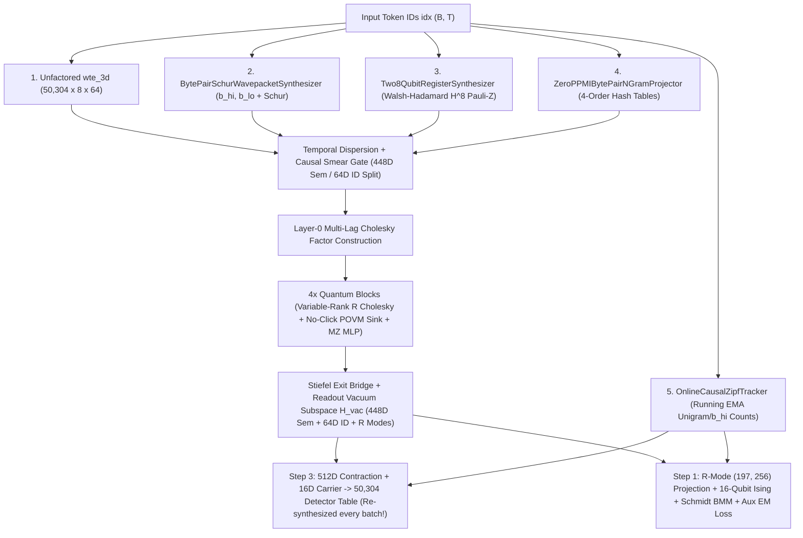

# Session Wrap-Up: Vacuum Subspaces, Uncollapsed Cholesky Density Highways, Zero-PPMI `uint16` Byte-Pair Readouts, and Architectural Consolidation (`Waves 58–62` / `EXPERIMENT_PLAN_078`–`082`)

## 1. Project Context, Benchmark Standard, & Target Outcomes

### 1.1 What Project We Are Building (`QuantumDLBlocks`)
`QuantumDLBlocks` is a deep learning research codebase investigating **quantum-inspired neural language model architectures**. Instead of representing token activations as unconstrained Euclidean vectors $\mathbf{h} \in \mathbb{R}^d$ transformed by unconstrained dense matrices, our models represent hidden states as **unit-norm wavepackets** $|\psi\rangle$ and **uncollapsed low-rank density matrices** $\rho = L^\dagger L$ evolving via orthogonal/unitary transformations on Riemannian manifolds:
- The **unit sphere** $\mathbb{S}^{d-1} = \{\mathbf{x} \in \mathbb{R}^d : \|\mathbf{x}\|_2 = 1\}$ (or constant-radius sphere scaled by $\sqrt{d}$ via Root-Mean-Square Normalization, $\operatorname{RMSNorm}(\mathbf{x}) = \mathbf{x} / \sqrt{\operatorname{MS}(\mathbf{x}) + \varepsilon}$ where $\operatorname{MS}(\mathbf{x}) = \frac{1}{d}\sum_{i=1}^d x_i^2$), and
- The **Stiefel manifold** $\operatorname{St}(n, p) = \{U \in \mathbb{R}^{n \times p} : U^\top U = I_p\}$ of matrices with orthonormal columns.

### 1.2 The Benchmark & Rules (`FineWeb` & `modded-nanogpt` Compliance)
All language-modeling experiments are evaluated on the canonical **`FineWeb`** benchmark (`kjj0/fineweb10B-gpt2`), matching [`KellerJordan/modded-nanogpt`](https://github.com/KellerJordan/modded-nanogpt):
- **Tokenizer & Vocabulary ($V = 50,257$)**: Standard GPT-2 Byte-Pair Encoding (BPE) vocabulary of `50,257` valid tokens (`0..50,256`). In GPU memory, vocabulary tables are padded by `47` unused rows to `50,304` (divisible by `64`/`128` for Tensor Cores); logits on padding rows `50,257..50,303` are masked to $-\infty$ before computing probabilities.
- **Training Data**: `900,000,000` tokens across 9 binary shards (`fineweb_train_000001.bin`..`000009.bin`, `100M` tokens/shard).
- **Validation Data (`10,485,760` Tokens)**: Held-out `FineWeb` Shard `0` (`fineweb_val_000000.bin`), evaluated over the exact first $10 \times 2^{20} = 10,485,760$ sequential tokens (`1,280` batches of $B \times T = 16 \times 512 = 8,192$ tokens).
- **Compliance Rules**:
  1. **External Signature**: Accept integer token IDs `idx` of shape `(B, T)` and output causal next-token Cross-Entropy (CE) loss in natural log units (**nats**) over the `50,257` valid GPT-2 tokens at every position $t$, without altering the token stream.
  2. **Zero Offline Data Precomputation**: Under strict speedrun rules, the model cannot pre-scan training shards before Step 1 to precompute co-occurrence statistics or initialize weights (`init_tokens_scanned == 0`).
  3. **Pure Neural Evaluation**: Validation Cross-Entropy (`Val CE`) and Perplexity ($\text{PPL} = e^{\text{Val CE}}$) must come directly from the neural network's forward pass, with zero external statistical $n$-gram table interpolation at evaluation time.

### 1.3 Hardware Testbed & Evaluation Horizons
All experiments run on a single workstation GPU (`1x NVIDIA RTX 5060 Ti 16 GB`) using a standardized testbed:
- **Backbone**: $L = 4$ quantum transformer blocks, width $d = 512$ partitioned into $H = 8$ **wavepacket heads** of `64` real floats each, viewed equivalently as a `32D` complex state vector $|\psi_{t,h}\rangle \in \mathbb{C}^{32}$ (`32` real + `32` imaginary parts = `64` real floats/head).
- **Batch & Horizons**: $B = 16$, $T = 512$ (`8,192` tokens/step), evaluated at **300 steps (`2.46M` tokens)** for rapid ablations and **1,200 steps (`9.83M` tokens)** for scaling verification.

### 1.4 Outcomes We Are Looking to Achieve
1. **Calibrated Step-0 Predictions Without Offline Scans**: Produce sensible token probabilities from Step 0 without external Kneser-Ney (KN) $n$-gram blending or offline Positive Pointwise Mutual Information (PPMI) scans.
2. **Geometric Abstention on Unit Spheres ("Saying I Don't Know")**: Give unit-normalized readout branches and causal attention heads a clean geometric way to output zero signal when uncertain, eliminating false-positive vocabulary collisions.
3. **Multi-Modal Expressivity via Uncollapsed Cholesky States**: Carry a rank-$R$ mixture of $R > 1$ quantum modes ($\rho = L^\dagger L$) so ambiguous contexts represent multiple next-token hypotheses simultaneously.
4. **Architectural Simplicity & High Throughput**: Achieve these gains without multi-mode `50,304`-token matrix multiplication bottlenecks or tangled auxiliary subsystems.

---

## 2. Starting Point Before This Session (`Waves 56–57` Baseline Architecture)

Prior to this session, our best 4-layer model (`D8` at 300 steps / `D9` at 1,200 steps from `EXPERIMENT_PLAN_077`) established the following baseline signal flow and optimizer design:

1. **Input Wavepacket & `448D` Semantic / `64D` Identity Split**:
   - Each input token $x_t \in \{0, \dots, 50256\}$ looks up a `512D` vector (`8` heads $\times$ `64D`).
   - Heads `h = 0..6` (`7 × 64D = 448D`) form the **Semantic Base subspace**: they undergo causal temporal dispersion (complex phase rotation + a learned 1-token causal smear gate mixing $t-1$ into $t$) to capture phrase context.
   - Head `h = 7` (`1 × 64D = 64D`) forms the **Identity Fiber subspace**: it bypasses temporal dispersion so exact single-token lexical identity is preserved.
2. **Layer-0 Multi-Horizon Cholesky Initialization**:
   - A pure quantum state $|\psi_{t,h}\rangle \in \mathbb{C}^{32}$ has a Rank-1 density matrix $\rho_{t,h} = |\psi_{t,h}\rangle\langle\psi_{t,h}|$, whereas a mixed state over $R$ hypotheses has a rank-$R$ density matrix $\rho_{t,h} = L_{t,h}^\dagger L_{t,h}$ parameterized by its **uncollapsed Cholesky factor** $L_{t,h} \in \mathbb{C}^{R \times 32}$ (whose $R$ rows are $R$ complex mode vectors in $\mathbb{C}^{32}$).
   - Entering Block 0, $L_{t,h}^{(0)} \in \mathbb{C}^{R \times 32}$ is seeded deterministically from local causal history: Row `r = 0` holds the current wavepacket $|\psi_{t,h}\rangle$; Rows `r = 1..4` hold phase-transported past wavepackets $|\tilde{\psi}_{t-\ell, h}\rangle$ at lags $\ell \in \{1..4\}$; and rows `r >= 5` (when $R > 5$) hold elementwise complex Schur products $|\psi_{t-\ell, h}\rangle \odot_{\mathbb{C}} |\psi_{t-\ell-1, h}\rangle$ of adjacent lags, normalized to $\|L_{t,h}^{(0)}\|_F = 1$.
3. **The 4 Quantum Transformer Blocks**:
   Each block evolves both the primary `512D` stream $\mathbf{h}_t$ and the rank-$R$ Cholesky factor $L_{t,h} \in \mathbb{C}^{R \times 32}$ through two sub-layers:
   - **Causal Hermitian-Born Cholesky Attention**: Computes causal Hermitian inner products between query $t$ and key $s \le t$, using non-negative Born weights $w_{t,s,h}$ to mix both $\mathbf{h}_t$ and all $R$ rows of $L_{t,h}$ (`Uncollapsed Cholesky Density Highway`).
   - **Mach-Zehnder (`MZ`) Interferometer MLP**: Splits the `512D` state into two beams via Stiefel orthogonal projections, applies nonlinear phase/gate modulations along each arm, and recombines them via a second Stiefel projection.
4. **Stiefel Exit Bridge & Readout Inputs**:
   - After Block 3, the primary `512D` stream passes through a learned SVD-structured **Stiefel Exit Bridge** $U \operatorname{diag}(\boldsymbol{\sigma}) V^\top$ ($U, V \in \operatorname{St}(512, 512)$, $\boldsymbol{\sigma} \in \mathbb{R}^{512}_+$) to align the trunk coordinate frame with the output detector sphere.
   - Thus, entering the readout at each position $t$, the model provides: (a) a **primary semantic anchor** $\mathbf{h}_{t,\text{sem}}^{\text{base}} \in \mathbb{R}^{448}$ from the main stream, and (b) **$R$ Cholesky mode states** $(\mathbf{h}_{t,\text{sem},r}, \mathbf{h}_{t,\text{id},r}) \in \mathbb{R}^{448} \times \mathbb{R}^{64}$ for $r \in \{0, \dots, R-1\}$, extracted by flattening row $r$ of the final Cholesky factor $L_{t,h}$ across semantic heads `h = 0..6` (`448D`) and identity head `h = 7` (`64D`).
5. **The `16D` Constant Carrier Trick for Homogeneous Unigram Bias**:
   - To add each token's unigram log-prior bias $b_{\text{uni}}[v] \in \mathbb{R}$ without a separate memory-bound elementwise pass over `(B, T, 50304)`, a fixed unit-norm constant vector $\mathbf{c}_0 \in \mathbb{R}^{16}$ ($\|\mathbf{c}_0\|_2 = 1$) is appended to the `512D` hidden state (`512 + 16 = 528D`) and $b_{\text{uni}}[v]\,\mathbf{c}_0 \in \mathbb{R}^{16}$ is stored in the last 16 columns of each token's `528D` detector row $\mathbf{w}_{\text{aug}}[v]$. Since $\langle b_{\text{uni}}[v]\,\mathbf{c}_0, \mathbf{c}_0 \rangle = b_{\text{uni}}[v]$, a single `528D` matrix multiplication (`GEMM`) computes both the `512D` inner product and bias addition.
6. **Three-Way Optimizer Partition**:
   - **`ModularRiemannianStiefelKrausMuon`**: Optimizes 2D/3D orthogonal trunk and Exit Bridge matrices via Newton-Schulz / Polar-Express orthogonalized momentum ($\beta = 0.70$, `LR = 0.03`) with Stiefel tangent-space projection and retraction.
   - **`BatchSubspaceTikhonovGramMuon`**: Optimizes the `50,304 × 512` input (`wte_3d`) and output (`w_det_512`) vocabulary tables using subspace Tikhonov Gram preconditioning (`LR = 0.045`, $\beta = 0.90$).
   - **`AdamW`**: Optimizes 1D scalar gates, temperatures, vacuum rest masses, and lookup tables (`LR = 0.006`).
7. **Three Baseline Limitations**:
   - **Offline PPMI Scans & KN Blending**: Required scanning `48M–900M` training tokens (`58.5s`) before Step 0 to initialize vocabulary tables via PPMI SVD.
   - **Unit-Sphere Forcing**: Every readout branch was `RMSNorm`-normalized onto a fixed-radius sphere, forcing uncertain branches and low-energy Cholesky modes to point in some direction on the sphere and generate noisy vocabulary overlaps.
   - **Hard Rank-$R=4$ Cap**: Increasing $R > 4$ injected noise from unexcited modes (`2.55 / 4` active modes).

---

## 3. Problems Solved & Experimental Progression (`Waves 58–62`)

### 3.1 Problem 1: Unit-Sphere Readout Forcing & the Orthogonal Vacuum Subspace $\mathcal{H}_{\text{vac}}$ (`EXPERIMENT_PLAN_078` / `Wave 58`)

#### The Geometric Problem & Why $\mathcal{H}_{\text{vac}}$ Beats an Extra `softmax` Class
On a unit sphere $\mathbb{S}^{d-1}$ with `50,304` detectors, an uncertain branch cannot shrink its norm $\|\mathbf{h}\|_2 \to 0$; even a random unit vector in `64D` has expected maximum cosine overlap $\approx \sqrt{2 \ln(50304) / 64} \approx 0.58$ with nearby tokens.
1. **Why an Extra $(V+1)$-th "Abstain" Class in `softmax` Hurts CE**: Adding an extra logit $z_{\text{null}}$ to $\operatorname{softmax}(z_1, \dots, z_V, z_{\text{null}})$ steals probability mass from the denominator, strictly *increasing* $-\ln P(y_{\text{true}})$ since $y_{\text{true}} \in \{0, \dots, V-1\}$.
2. **Why an Orthogonal Vacuum Subspace $\mathcal{H}_{\text{vac}}$ Inside the Sphere Improves CE**: We augment the readout sphere from $\mathbb{S}^{d-1}$ to $\mathbb{S}^{(d + d_{\text{vac}}) - 1} = \mathcal{H}_{\text{vocab}} \oplus \mathcal{H}_{\text{vac}}$ ($d_{\text{vac}} = 4$) where every vocabulary detector $\mathbf{w}_v$ has **identically zero entries on $\mathcal{H}_{\text{vac}}$**. For a branch vector $\mathbf{u}_{\text{vocab}} \in \mathbb{R}^d$ and learned scalar **vacuum rest mass** $m_{\text{vac}}(r)$ (representing $\mathbf{u}_{\text{vac}} = (m_{\text{vac}}(r), \dots, m_{\text{vac}}(r)) \in \mathbb{R}^{d_{\text{vac}}}$ with $\operatorname{MS}(\mathbf{u}_{\text{vac}}) = m_{\text{vac}}(r)^2$), projecting onto $\mathcal{H}_{\text{vocab}}$ after joint sphere normalization gives:
   $$\mathbf{h}_{\text{vocab}} \;=\; \frac{\mathbf{u}_{\text{vocab}}}{\sqrt{\operatorname{MS}(\mathbf{u}_{\text{vocab}}) + m_{\text{vac}}(r)^2 + \varepsilon}} \;=\; \cos\theta_{\text{vac}}(t, r) \cdot \operatorname{RMSNorm}(\mathbf{u}_{\text{vocab}})$$
   where $\operatorname{MS}(\mathbf{u}_{\text{vocab}, t, r})$ is proportional to mode $r$'s Cholesky energy $E_{t,r} = \sum_{\text{dim}} |L_{t,h}[r, :]|^2$, and
   $$\cos\theta_{\text{vac}}(t, r) \;=\; \sqrt{\frac{\operatorname{MS}(\mathbf{u}_{\text{vocab}, t, r})}{\operatorname{MS}(\mathbf{u}_{\text{vocab}, t, r}) + m_{\text{vac}}(r)^2 + \varepsilon}} \;\in\; [0, 1]$$
   is the cosine of the angle to $\mathcal{H}_{\text{vocab}}$. When mode energy $E_{t,r}$ is large, $\cos\theta_{\text{vac}} \to 1$; when $E_{t,r} \to 0$, $m_{\text{vac}}(r)^2$ dominates, rotating the state into $\mathcal{H}_{\text{vac}}$ ($\cos\theta_{\text{vac}} \to 0$) and smoothly zeroing its vocabulary logits without stealing probability mass from `softmax`.

#### Multi-Mode Readout Equations & Definition of `Effective Active Modes` ($R_{\text{eff}}$)
For each mode $r \in \{0, \dots, R-1\}$, a linear head outputs three scalar controls $(\beta_{t,r}, \tau_{t,r}, \alpha_{t,r})$: semantic perturbation gate $\beta_{t,r} \in \mathbb{R}$, identity scale $\tau_{t,r} \in \mathbb{R}_+$, and mode log-weight $\alpha_{t,r} = \ln(E_{t,r} + \varepsilon) + b_{\text{mode}, r}$ with mixture weights $\pi_{t,r} = \operatorname{softmax}_r(\alpha_{t,r})$. In `Waves 58–61`, each mode produced its own logit vector $z_{t,r,v}$ (softcapped via $\operatorname{softcap}(z) = 18 \tanh(z / 18)$) and mixed probabilities via log-sum-exp:
$$z_{t,r,v} \;=\; \big\langle \mathbf{w}_{v,\text{sem}},\, \mathbf{h}_{t,\text{sem}}^{\text{base}} + \beta_{t,r}\mathbf{h}_{t,\text{sem},r} \big\rangle \;+\; \tau_{t,r}\big\langle \mathbf{w}_{v,\text{id}},\, \mathbf{h}_{t,\text{id},r} \big\rangle \;+\; b_{\text{uni}}[v], \qquad \ln P(v \mid t) \;=\; \ln \sum_{r=0}^{R-1} \pi_{t,r} \operatorname{softmax}_v\!\big(\operatorname{softcap}(z_{t,r,v})\big)$$
We measure mode participation via **Effective Active Modes ($R_{\text{eff}}$)**, defined as the exponential of the Shannon entropy (perplexity) of $\pi_{t,r}$:
$$R_{\text{eff}} \;=\; \exp\!\left(-\frac{1}{BT}\sum_{t=1}^{BT}\sum_{r=0}^{R-1} \pi_{t,r}\ln \pi_{t,r}\right) \;\in\; [1, R]$$

#### Empirical Outcome (`Wave 58`: `V0..V4` at $R = 4$, `alpha_kn = 0.0`)
- **`V0` (Unit-Sphere Baseline, $d_{\text{vac}} = 0$, 300 steps)**: `5.6915` Val CE (`296.34` PPL, `2.55 / 4` active modes).
- **`V1` (+ Readout $\mathcal{H}_{\text{vac}}$, $d_{\text{vac}} = 4$, 300 steps)**: `5.6812` Val CE (`293.30` PPL, `-0.0103` nats).
- **`V2` (`V1` + Layer-0 Multi-Lag Cholesky Init, 300 steps)**: `5.6801` Val CE (`292.98` PPL, `2.79 / 4` active modes).
- **`V3` (`V2` + 4 Independent `512D` Sem+ID Modes, 300 steps)**: **`5.6795` Val CE (`292.80` PPL, `21.65%` Top-1, `37.66%` Top-5, `2.86 / 4` active modes)**.
- **`V4` (1,200-Step Scaling of `V3`)**: **`5.1771` Val CE (`177.17` PPL, `24.71%` Top-1, `41.58%` Top-5, `2.86 / 4` active modes)**, beating `D9` (`5.1846`).

---

### 3.2 Problem 2: Lifting the Artificial $R = 4$ Cholesky Rank Restriction (`EXPERIMENT_PLAN_079` / `Wave 59`)

- **Solution**: Generalized causal Cholesky attention (`fused_variable_rank_cholesky_ket_attention`) to arbitrary rank $R \in [1, 16]$ with **Progressive Vacuum Rest-Mass Parking**: modes `r = 1..3` start partially active ($\cos\theta_{\text{vac}} \approx 0.89$), while higher modes `r >= 4` start parked deeper in $\mathcal{H}_{\text{vac}}$ ($\cos\theta_{\text{vac}} \approx 0.81$) and only rotate into $\mathcal{H}_{\text{vocab}}$ when attention excites their energy $E_{t,r}$.
- **Empirical Outcome (`Wave 59`: `R0..R6`)**:
  - **`R0` ($R = 2$, 300 steps)**: `5.6808` Val CE (`293.18` PPL, `1.74 / 2` active modes).
  - **`R1` ($R = 4$, 300 steps)**: `5.6795` Val CE (`292.80` PPL, `2.86 / 4` active modes).
  - **`R2` ($R = 6$, 300 steps)**: `5.6766` Val CE (`291.95` PPL, `3.55 / 6` active modes).
  - **`R3` ($R = 8$, Uniform Vacuum Mass, 300 steps)**: `5.6754` Val CE (`291.61` PPL, `3.91 / 8` active modes).
  - **`R4` ($R = 8$, Progressive Vacuum Parking, 300 steps)**: `5.6744` Val CE (`291.32` PPL, `5.12 / 8` active modes).
  - **`R5` ($R = 12$, Progressive Vacuum Parking, 300 steps)**: **`5.6739` Val CE (`291.17` PPL, `21.67%` Top-1, `37.70%` Top-5, `4.53 / 12` active modes)**.
  - **`R6` (1,200-Step Scaling of `R4` at $R = 8$)**: **`5.1717` Val CE (`176.22` PPL, `24.74%` Top-1, `41.61%` Top-5, `6.50 / 8` active modes)**.

---

### 3.3 Problem 3: Trunk "No-Click" POVM Attention Sink, Mode Specialization, Removing `softmax`, & Momentum-Free SGD (`EXPERIMENT_PLAN_080` / `Wave 60`)

1. **Trunk Quantum "No-Click" POVM Attention Vacuum Sink (`N1..N4`)**:
   - *Formulation*: Standard causal attention forces weights across prior tokens $s \le t$ to sum to 1 even when no prior token is relevant. We equipped each attention head $h$ with a learned unit-norm **vacuum key** $|k_{\text{vac}, h}\rangle \in \mathbb{C}^{32}$ and scalar mass $m_{\text{attn\_vac}, h}$ whose value and Cholesky excitation are identically zero ($|v_{\text{vac}, h}\rangle \equiv \mathbf{0}, L_{\text{vac}, h} \equiv \mathbf{0}$). Given causal Born overlaps $A_{t,s,h} \ge 0$ ($s \le t$) and vacuum overlap $A_{t,\text{vac},h} = m_{\text{attn\_vac}, h}^2 |\langle q_{t,h} \mid k_{\text{vac}, h} \rangle|^2 \ge 0$:
     $$w_{t,s,h} \;=\; \frac{A_{t,s,h}}{\sum_{s' \le t} A_{t,s',h} + A_{t,\text{vac},h}}, \qquad p_{\text{noclick}, t, h} \;=\; \frac{A_{t,\text{vac},h}}{\sum_{s' \le t} A_{t,s',h} + A_{t,\text{vac},h}} \;\in\; [0, 1]$$
     Thus the attended context sum is automatically damped by $(1 - p_{\text{noclick}, t, h}) = \sum_{s \le t} w_{t,s,h} \le 1$.
   - *Outcome*: **`N1` ($R=8$, 300 steps)** reached **`5.6699` Val CE** (`6.07 / 8` modes); **`N2` ($R=12$, 300 steps)** reached **`5.6699` Val CE** (`7.39 / 12` modes); **`N3` ($R=8$, 1,200 steps)** reached `5.1717`; and **`N4` ($R=12$ + No-Click Sink, 1,200 steps)** achieved our best PPMI-initialized pure-neural result: **`5.1697` Val CE (`175.86` PPL, `24.75%` Top-1, `41.66%` Top-5, `8.11 / 12` active modes, `p_noclick = 0.251`)**.
2. **Per-Mode Specialization Profile (`scripts/cholesky_mode_spectrum_and_vacuum_angle_profiler.py`)**:
   - On 1,200-step checkpoints (`N3`/`N4`), Mode `r = 0` (`37%–44%` mixture weight, $\cos\theta_{\text{vac}} \approx 0.96$) anchors ultra-frequent tokens (Zipf Decile 0), Modes `r = 1..3` ($\cos\theta_{\text{vac}} \approx 0.89$) capture mid-lag phrases, and Modes `r = 4..11` ($\cos\theta_{\text{vac}} \approx 0.81$) wake up on rare tail words (Deciles 5–9).
3. **Why Ripping Out `softmax` for Polynomial Born Readouts Stalled (`B0..B2`, 300 steps, $R=8$)**:
   - Replacing `softmax` with $P(v \mid t) = \lfloor z_{t,v} \rfloor_+^{2p} / \sum_{v'} \lfloor z_{t,v'} \rfloor_+^{2p}$ gave `7.4210` Val CE at $2p=2$ (`B0`), `6.9815` at $2p=4$ (`B1`), and **`6.8091` (`906.05` PPL)** at $2p=6$ with vacuum sharpening (`B2`). In `512D` with `50,257` tokens, `~38,700` background tokens have positive cosine overlap (`~0.044` RMS); `exp` suppresses them exponentially, whereas under degree-$2p \le 6$ polynomials the `38,700`-token background sum absorbs `> 60%` of the denominator.
4. **Leslie Smith Momentum-Free ($\beta = 0$) 1-Cycle SGD (`S0..S1`, 300 steps, $R=8$)**:
   - The LR Range Test (`S0`) showed Stiefel trunk matrices remain stable up to **`LR = 0.25`** (`8.3x` higher than baseline `0.03`). However, 300-step $\beta = 0$ 1-Cycle SGD (`S1`) reached `6.0005` Val CE vs. `5.6699` with momentum ($\beta = 0.70$) due to **vocabulary sparsity**: one `8,192`-token batch hits only `~2,690` unique tokens (`5.36%` of `50,257`), leaving `94.64%` of unfactored vocabulary rows with zero gradient per step.

---

### 3.4 Problem 4: Strict `modded-nanogpt` Compliance via Deterministic `uint16` Radix Byte-Pairs (`EXPERIMENT_PLAN_081` / `Wave 61`)

#### The Deterministic `uint16` Radix Byte-Pair Bijection (`init_tokens_scanned == 0`)
To eliminate the offline PPMI pre-scan (`init_tokens_scanned == 0`) and solve the `5.36%` vocabulary sparsity bottleneck without touching the external token stream, we used the exact 16-bit integer bijection for every GPT-2 token ID $v \in \{0, \dots, 50256\}$:
$$b_{\text{hi}}(v) \;=\; v \gg 8 \;\in\; \{0, \dots, 196\}, \qquad b_{\text{lo}}(v) \;=\; v \ \& \ \text{0xFF} \;\in\; \{0, \dots, 255\}, \qquad v \;=\; 256\,b_{\text{hi}}(v) + b_{\text{lo}}(v)$$
1. **Built-In BPE Merge-Frequency Prior at Step 0**: Because GPT-2's BPE vocabulary is ordered by greedy merge frequency, `b_hi = 0` ($v \in [0, 255]$) holds raw bytes, `b_hi = 1..3` ($v \in [256, 1023]$) holds top English subwords (`53.18%` of all FineWeb token occurrences!), and `b_hi = 4..196` holds rarer words. A static analytical Zipf law $\hat{\ell}_0(v) = -1.08 \ln(\max(v, 256) + 64)$ drops Step-0 Val CE from `10.8258` to **`8.9050` (`-1.92` nats)** in `18.3 ms` with **zero tokens scanned**.
2. **Online Causal EMA (`OnlineCausalZipfTracker`) & Causal Byte-Pair N-Gram Projector (`ZeroPPMIBytePairNGramProjector`, `Z1`)**: `OnlineCausalZipfTracker` updates running EMA token/`b_hi` frequencies strictly from training batches during `model.training` (`0.9854` correlation with true unigram prior by Step 300). `ZeroPPMIBytePairNGramProjector` hashes current `(b_hi, b_lo)` and lag-1/2 `b_hi` into four zero-initialized `4,096 × 64` tables trained online via gradients.
3. **Factored `(b_hi, b_lo)` + Schur Wavepackets & Detectors (`Z2` — `100.0%` Step-1 Vocab Coverage)**: Parameterizing token representations as $\Delta W[v] + U_{\text{hi}}[b_{\text{hi}}(v)] + U_{\text{lo}}[b_{\text{lo}}(v)] + (P_{\text{hi}}[b_{\text{hi}}(v)] \odot P_{\text{lo}}[b_{\text{lo}}(v)])$ updates **`100.0%` of the `50,257` vocabulary representations on Step 1** (vs. `5.36%` in unfactored `Z0`).
4. **Exact Chain-Rule Two-Byte Readout (`Z3` — Why Training Was `3.46x` Faster Yet Full-Vocab Val CE Was `6.7474`)**: Factoring $\ln P(v \mid h_t) = \ln P(b_{\text{hi}}(v) \mid h_t) + \ln P(b_{\text{lo}}(v) \mid h_t, b_{\text{hi}}(v))$ evaluates only `197 + 256 = 453` outcomes per token on the ground-truth bucket $b_{\text{hi}}(y_t)$ during training, cutting training time by **`3.46x` (`255.8s` vs. `885.3s`)** and lifting Top-1 accuracy to `17.07%` (vs. `16.76%` `Z0`). However, because `Z3` parameterized a separate low-byte table per high-byte bucket that was only updated on $b_{\text{hi}}(y_t)$, rare buckets ($b_{\text{hi}} \ge 40$) were starved of updates and poorly calibrated during full `50,257`-token validation (`6.7474` Val CE).

#### Empirical Outcome (`Wave 61`: `Z0..Z5`, All with `0` Pre-Scanned Tokens)
- **`Z0` (Unfactored Cold-Start Baseline, $R=8$, 300 steps)**: `6.2710` Val CE (`529.00` PPL, `16.76%` Top-1, `5.36%` Step-1 vocab coverage).
- **`Z1` (`Z0` + Online EMA + Byte-Pair N-Gram, $R=8$, 300 steps)**: `6.2271` Val CE (`506.27` PPL, `16.96%` Top-1).
- **`Z2` (`Z1` + Factored `(b_hi, b_lo)` + Schur, $R=8$, 300 steps)**: **`6.1292` Val CE (`459.07` PPL, `-0.1418` nats vs. `Z0`, `18.37%` Top-1, `32.92%` Top-5, `100.0%` Step-1 vocab coverage)**.
- **`Z3` (Chain-Rule `197 + 256` Readout, $R=8$, 300 steps)**: `6.7474` Val CE (`851.87` PPL, `17.07%` Top-1, **`3.46x` faster training**).
- **`Z4` (`Z2` at $R=12$ + `15D` Contextual `b_hi` Carrier Projection, 300 steps)**: `6.1490` Val CE (`468.25` PPL, `3.31 / 12` modes).
- **`Z5` (1,200-Step Scaling of `Z4` at $R=12$)**: **`5.2807` Val CE (`196.51` PPL, `24.34%` Top-1, `41.04%` Top-5, `3.61 / 12` modes)**, closing **`94.4%`** of the `1.97`-nat cold-start gap vs. `900M`-token PPMI (`N4`'s `5.1697`).

---

### 3.5 Problem 5: Readout Compute Bottleneck, Two 8-Qubit Registers ("Qubytes"), Steps 1–3, & Sprawl (`EXPERIMENT_PLAN_082` / `Wave 62`)

In `Z2`/`Z4`/`Z5`, the readout evaluated the `50,304`-token vocabulary matmul **separately for each of the $R$ modes** ($1 + 2R = 17$ full-vocab GEMMs in forward and $34$ in backward at $R=8$). We formulated four readout optimizations (`Steps 1–4`) plus a **Two 8-Qubit Register ("Qubyte")** representation of `(b_hi, b_lo)`:
- **Step 1 — Distribute the $R$ Cholesky Modes Over the `(197, 256)` Byte-Pair Basis *Before* Vocabulary Expansion**: Projecting all $R$ modes onto the `197` high-byte and `256` low-byte basis matrices costs only **$197 + 256 = 453$ dot products/mode** (**`110.94x` fewer FLOPs** than `50,257`/mode, verified to `1.14e-5` max algebraic difference).
- **Step 2 — Shared-Basis Conditional Chain-Rule Readout (`453` Outcomes)**: Share `U_lo` and Schur factors across all `197` buckets in `Z3`'s chain-rule readout so rare `b_hi` buckets never starve *(reserved for future test)*.
- **Step 3 — Contract the $R$ Cholesky Modes Linearly in `512D` Latent Space *First* (`1` Vocabulary GEMM Total)**:
  Contract the $R$ vacuum-gated modes in `512D` using $\pi_{t,r} = \operatorname{softmax}_r(\alpha_{t,r})$ before multiplying by the `50,304` detector table:
  $$\bar{\mathbf{h}}_{t,\text{sem}} \;=\; \mathbf{h}_{t,\text{sem}}^{\text{base}} + \sum_{r=0}^{R-1} \pi_{t,r}\,\beta_{t,r}\,\mathbf{h}_{t,\text{sem},r} \;\in\; \mathbb{R}^{448}, \qquad \bar{\mathbf{h}}_{t,\text{id}} \;=\; \sum_{r=0}^{R-1} \pi_{t,r}\,\tau_{t,r}\,\mathbf{h}_{t,\text{id},r} \;\in\; \mathbb{R}^{64}$$
  cutting `50,304`-token GEMMs from `17` (`R=8`) in forward down to **1 in forward and 2 in backward**!
- **Step 4 — Top-$K$ `b_hi` Beam Pruning at Inference Time**.
- **Two 8-Qubit Registers ("Qubytes": $(\mathbb{C}^2)^{\otimes 8}_{\text{hi}} \otimes (\mathbb{C}^2)^{\otimes 8}_{\text{lo}}$)**: Represent $b_{\text{hi}} \in \{0..196\}$ (`qubits 15..8`) and $b_{\text{lo}} \in \{0..255\}$ (`qubits 7..0`) in the $256 \times 256$ **8-qubit Walsh-Hadamard / Pauli-$Z^{\otimes S}$ basis** $H^{\otimes 8}_{b,S} = \frac{1}{16}(-1)^{\operatorname{popcount}(b\,\&\,S)}$, where Hamming weight $\operatorname{popcount}(S) = 1$ gives the 8 single-qubit magnetizations $Z_j$, weight 2 gives the 28 pairwise Ising couplings $Z_i Z_j$, and across registers the $R$ modes form a **Rank-$R$ Bipartite Schmidt Entanglement** $\Omega_t[b_{\text{hi}}, b_{\text{lo}}] = \sum_{r=0}^{R-1} \pi_{t,r} A_{t,r}[b_{\text{hi}}] B_{t,r}[b_{\text{lo}}]$ via batched matmul (`Schmidt BMM`: `(N, 197, R) @ (N, R, 256)`).

#### What the `Wave 62` Profiler & `Q0..Q1` Runs Proved—and Why We Cancelled `Q1..Q5` to Consolidate
1. **FineWeb Shard-0 (`10.48M`-Token) 8-Qubit Walsh-Hadamard Audit**: In the High 8-Qubit Register (`b_hi`), the 8 single-qubit Pauli-$Z_j$ magnetizations (`weight 1`) capture **`80.00%`** of empirical log-frequency variance and `weight <= 2` ($Z_j, Z_i Z_j$, 36 basis vectors) captures **`94.33%`**. In the Low 8-Qubit Register (`b_lo`), single-qubit entropy is near-maximal (`7.867 / 8.000` bits) with variance spread across multi-qubit parity orders (`65.34%` for `weight <= 4`).
2. **Major Win for `Q0` (`Step 3 Only` — Latent `512D` Contraction, 300 Steps)**:
   - `Q0` cut training step time by **`3.17x`** (`879.4 ms/step` vs. `2,786.6 ms/step` in `Z2`) **AND improved 300-step Zero-PPMI Val CE from `6.1292` (`Z2`) to `6.0794` (`436.76` PPL, `-0.0498` nats / `-22.3` PPL better than `Z2`, `33.41%` Top-5)**!
   - *Why $R_{\text{eff}}$ Dropped to `1.50 / 8` in `Q0` While Val CE Improved*: In `Z2`, the log-sum-exp probability mixture $\ln \sum_r \pi_{t,r} P_r(y_t)$ gives $\alpha_{t,r}$ an Expectation-Maximization (EM) posterior responsibility gradient $(\pi_{t,r} - \gamma_{t,r})$ that rewards modes for specializing on different tokens, but injects inter-mode softmax competition noise. In `Q0`, summing modes linearly in `512D` before one `softmax` gives all modes a clean, unified gradient while allowing $\pi_{t,r}$ to concentrate on the top 1–2 dominant modes (`1.50 / 8`). Meanwhile, `Q1` (`Step 1 + Step 3` with an auxiliary `0.05`-weighted EM loss `Aux EM Loss` on the `(197, 256)` mode mixture) reached Step 200 at **`6.2415` Val CE** (ahead of `Q0`'s Step-200 `6.2598`) with `6.32 / 8` active modes before cancellation.
3. **Why We Cancelled the Remaining `Q1..Q5` Sweep (`Q2`: 16-Qubit Ising, `Q3`/`Q4`: Rank-$R$ Schmidt at $R=8,12$, `Q5`: 1.2k scale)**:
   - Each `10.48M`-token validation checkpoint still took `~230s` because `build_multibranch_readout_tensors` re-synthesized the `50,304 × 512` detector matrix from `(u_hi, u_lo, schur, walsh)` on **every one of the `1,280` validation batches** instead of caching it or projecting in the `453`-state byte-pair space. More importantly, 6 levels of class inheritance had accumulated too many overlapping subsystems.

---

## 4. Master Summary Table of Key Empirical Runs (`Waves 57–62`)

All runs use $L = 4, d = 512, B = 16, T = 512$ (`8,192` tokens/step), evaluated on the `10,485,760`-token FineWeb Shard-0 benchmark (`Pure Neural Val CE`):

| Wave / Plan | Run ID | Key Architectural Mechanism | Pre-Scanned Init Tokens | Horizon (Steps) | Cholesky Rank $R$ | Val CE (`PPL`) | Top-1 / Top-5 Acc | Effective Active Modes $R_{\text{eff}}$ |
| :--- | :--- | :--- | :---: | :---: | :---: | :---: | :---: | :---: |
| `W57` (`Plan 077`) | `D8` | Unit-Sphere Readout Baseline ($d_{\text{vac}}=0$) | `48M–900M` (PPMI) | `300` | `4` | `5.6915` (`296.34`) | `21.62%` / `37.56%` | `2.55 / 4` |
| `W57` (`Plan 077`) | `D9` | Unit-Sphere Readout Baseline ($d_{\text{vac}}=0$, 1.2k scale) | `48M–900M` (PPMI) | `1,200` | `4` | `5.1846` (`178.50`) | `24.63%` / `41.48%` | `2.55 / 4` |
| `W58` (`Plan 078`) | `V3` | **+ Readout Vacuum Subspace $\mathcal{H}_{\text{vac}}$ ($d_{\text{vac}}=4$) + Layer-0 Cholesky** | `48M–900M` (PPMI) | `300` | `4` | `5.6795` (`292.80`) | `21.65%` / `37.66%` | `2.86 / 4` |
| `W58` (`Plan 078`) | `V4` | **+ Readout Vacuum Subspace $\mathcal{H}_{\text{vac}}$ ($d_{\text{vac}}=4$, 1.2k scale)** | `48M–900M` (PPMI) | `1,200` | `4` | `5.1771` (`177.17`) | `24.71%` / `41.58%` | `2.86 / 4` |
| `W59` (`Plan 079`) | `R4` | **+ Unrestricted Cholesky Rank $R=8$ with Progressive Vacuum Parking** | `48M–900M` (PPMI) | `300` | `8` | `5.6744` (`291.32`) | `21.66%` / `37.69%` | `5.12 / 8` |
| `W59` (`Plan 079`) | `R5` | **+ Unrestricted Cholesky Rank $R=12$ with Progressive Vacuum Parking** | `48M–900M` (PPMI) | `300` | `12` | `5.6739` (`291.17`) | `21.67%` / `37.70%` | `4.53 / 12` |
| `W59` (`Plan 079`) | `R6` | **+ Unrestricted Cholesky Rank $R=8$ (1.2k scale)** | `48M–900M` (PPMI) | `1,200` | `8` | `5.1717` (`176.22`) | `24.74%` / `41.61%` | `6.50 / 8` |
| `W60` (`Plan 080`) | `N2` | **+ Trunk "No-Click" POVM Attention Vacuum Sink ($R=12$)** | `48M–900M` (PPMI) | `300` | `12` | **`5.6699` (`290.00`)** | `21.69%` / `37.75%` | `7.39 / 12` |
| `W60` (`Plan 080`) | `N4` | **+ Trunk "No-Click" POVM Attention Vacuum Sink ($R=12$, 1.2k scale)** | `48M–900M` (PPMI) | `1,200` | `12` | **`5.1697` (`175.86`)** | **`24.75%` / `41.66%`** | **`8.11 / 12`** |
| `W60` (`Plan 080`) | `B2` | 100% `softmax`-Free Vacuum Coincidence Born Readout ($2p=6$) | `48M–900M` (PPMI) | `300` | `8` | `6.8091` (`906.05`) | `13.48%` / `27.71%` | `7.89 / 8` |
| `W60` (`Plan 080`) | `S1` | Leslie Smith Momentum-Free ($\beta=0$) 1-Cycle SGD (`LR=0.25`) | `48M–900M` (PPMI) | `300` | `8` | `6.0005` (`403.63`) | `18.30%` / `34.16%` | `1.88 / 8` |
| `W61` (`Plan 081`) | `Z0` | **Zero-PPMI Cold-Start Baseline** (Unfactored `50,304` Table, Static Zipf) | **`0` (Compliant)** | `300` | `8` | `6.2710` (`529.00`) | `16.76%` / `32.16%` | `2.07 / 8` |
| `W61` (`Plan 081`) | `Z1` | **+ Online Causal Training-Stream EMA + Byte-Pair N-Gram** | **`0` (Compliant)** | `300` | `8` | `6.2271` (`506.27`) | `16.96%` / `32.59%` | `2.08 / 8` |
| `W61` (`Plan 081`) | `Z2` | **+ Factored `uint16` `(b_hi, b_lo)` + Schur Wavepackets & Detectors** | **`0` (Compliant)** | `300` | `8` | `6.1292` (`459.07`) | **`18.37%`** / `32.92%` | `2.19 / 8` |
| `W61` (`Plan 081`) | `Z3` | **+ Exact Chain-Rule `197 + 256` Readout (`3.46x` faster training)** | **`0` (Compliant)** | `300` | `8` | `6.7474` (`851.87`) | `17.07%` / `30.89%` | `2.19 / 8` |
| `W61` (`Plan 081`) | `Z4` | **+ $R=12$ Factored `(b_hi, b_lo)` + `15D` Contextual `b_hi` Carrier** | **`0` (Compliant)** | `300` | `12` | `6.1490` (`468.25`) | `18.14%` / `32.78%` | `3.31 / 12` |
| `W61` (`Plan 081`) | `Z5` | **+ 1,200-Step Scaling of `Z4` ($R=12$ Zero-PPMI Byte-Pair)** | **`0` (Compliant)** | `1,200` | `12` | **`5.2807` (`196.51`)** | **`24.34%` / `41.04%`** | `3.61 / 12` |
| `W62` (`Plan 082`) | **`Q0`** | **+ Step 3 Latent `512D` Cholesky Contraction (`1` GEMM, `3.17x` faster step)** | **`0` (Compliant)** | `300` | `8` | **`6.0794` (`436.76`)** | `17.55%` / **`33.41%`** | `1.50 / 8` |

---

## 5. Diagnosis of Architectural Complexity Sprawl (Why We Are Stepping Back)

By `Wave 62`, the 6-level inheritance chain (`NativeCholeskyDensityWavepacketGPT -> VacuumSubspaceCholeskyGPT -> VariableRankCholeskyVacuumGPT -> NoClickVacuumCholeskyGPT -> ZeroPPMIBytePairCholeskyGPT -> TwoQubyteRegisterCholeskyGPT`) had accumulated **seven overlapping mechanisms**:

1. **Three Competing Parameterizations of the Same `(b_hi, b_lo)` Vocabulary Table**: The model maintains (a) full `50,304 × 512` `wte_3d` and `w_det_512` tables, (b) `BytePairSchurWavepacketSynthesizer`, AND (c) `Two8QubitRegisterSynthesizer`, summing all three and re-synthesizing the `50,304 × 512` matrix `1,280` times during every validation checkpoint.
2. **Multi-Mode Softmax Competition vs. `Step 3` Latent `512D` Contraction**: Contracting the $R$ modes in `512D` before a single `50,304` GEMM (`Q0`) is `3.17x` faster and `0.0498` nats more accurate than $R$ separate `50,304`-way softmaxes (`Z2`).
3. **Artificial `448D` Semantic / `64D` Identity / `16D` Carrier Slicing**: Requires separate temperature scalars, separate vacuum rest masses, and separate optimizer groups for each slice.
4. **Redundant Short-Range Input Context Pathways**: Complex temporal dispersion, a 1-token `smear_gate`, and the 4-order `ZeroPPMIBytePairNGramProjector` all overlap before Layer-0 multi-lag Cholesky construction.

---

## 6. Recommended Next Steps: Architectural Simplification & Unification Roadmap

Our next wave should **strip the architecture down to a single, flat, self-contained module** (`<= 500` SLOC, zero class inheritance) built around four clean steps:

1. **Step A — Adopt `Step 3` Latent `512D` Cholesky Contraction (`1` Vocabulary GEMM) as the Canonical Readout**:
   Eliminate the `(chunk_len, R, 50304)` multi-mode vocabulary loop permanently. Optionally retain only the lightweight `Step 1` `(197, 256)` byte-pair mode projection (`453` dot products/mode) if needed to keep $R_{\text{eff}} > 4$.
2. **Step B — Unify the Byte-Pair / 8-Qubit Walsh-Hadamard Vocabulary Parameterization with Zero `50,304 × 512` Re-Synthesis**:
   Use **one** factored parameterization $W_{\text{vocab}}[v] = \Delta W[v] + U_{\text{hi}}[b_{\text{hi}}(v)] + U_{\text{lo}}[b_{\text{lo}}(v)] + (P_{\text{hi}}[b_{\text{hi}}(v)] \odot P_{\text{lo}}[b_{\text{lo}}(v)])$ where $U_{\text{hi}} \in \mathbb{R}^{197 \times d}, U_{\text{lo}} \in \mathbb{R}^{256 \times d}$ are expressed directly in the $256 \times 256$ 8-qubit Walsh-Hadamard Pauli-$Z$ basis $H^{\otimes 8}$. By linearity of the inner product:
   $$\big\langle W_{\text{vocab}}[v],\, \bar{\mathbf{h}}_t \big\rangle \;=\; \big\langle \Delta W[v],\, \bar{\mathbf{h}}_t \big\rangle \;+\; \big\langle U_{\text{hi}}[b_{\text{hi}}(v)],\, \bar{\mathbf{h}}_t \big\rangle \;+\; \big\langle U_{\text{lo}}[b_{\text{lo}}(v)],\, \bar{\mathbf{h}}_t \big\rangle \;+\; \big\langle P_{\text{hi}}[b_{\text{hi}}(v)],\, P_{\text{lo}}[b_{\text{lo}}(v)] \odot \bar{\mathbf{h}}_t \big\rangle$$
   we **never** materialize a `50,304 × 512` sum tensor `w_det_synth`—computing the `197`-way and `256`-way dot products with $\bar{\mathbf{h}}_t$ in `< 0.1 ms` and adding them to $\Delta W \bar{\mathbf{h}}_t$ (eliminating the `230s` validation bottleneck immediately).
3. **Step C — Unify the `512D` Readout Sphere + Vacuum Subspace $\mathcal{H}_{\text{vac}}$ (Drop the `448D/64D/16D` Split)**:
   Replace the `448D/64D/16D` split with a single `512D` vocabulary sphere plus $d_{\text{vac}} = 4$ vacuum subspace ($\mathcal{H}_{\text{vocab}}^{(512)} \oplus \mathcal{H}_{\text{vac}}^{(4)}$) and a direct scalar unigram bias $b_{\text{uni}}[v]$.
4. **Step D — Clean Ablation at 300 & 1,200 Steps**:
   Benchmark the consolidated model (`No-Click POVM` + `Uncollapsed Cholesky Highway` + `Step 3 Single-GEMM Byte-Pair Readout`) targeting `< 90s` for 300 steps (including full `10.48M`-token validation) and `< 6.05` Val CE at 300 steps / `< 5.20` at 1,200 steps (`0` pre-scanned tokens).
